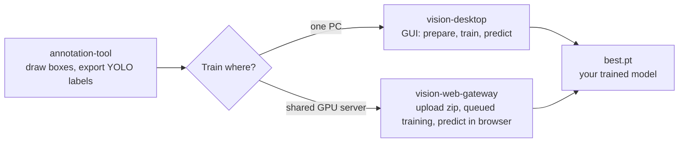

# yolo-vision-toolkit

No-code toolkit to label images, train an Ultralytics YOLO object detector, and run predictions, either on one PC (desktop GUI) or as a shared multi-user training server (web gateway). Built for engineers who need a vision model but do not want to write training code.



## What is inside

| Folder | What it does | Who uses it |
|---|---|---|
| [`annotation-tool/`](annotation-tool/docs/README.md) | One-click installer and launcher for the open-source [X-AnyLabeling](https://github.com/CVHub520/X-AnyLabeling) (not my work, see credits) to draw bounding boxes and export YOLO `.txt` labels | Anyone labeling data |
| [`vision-desktop/`](vision-desktop/docs/README.md) | Tkinter GUI over one config file: dataset split, training, prediction. Auto-detects GPU/CPU and picks batch size, workers, cache and AMP from free hardware | One engineer on one PC |
| [`vision-web-gateway/`](vision-web-gateway/docs/README.md) | FastAPI web app: users upload a dataset zip, jobs run in a queue on a GPU server, live metrics charts, predict on images or video, email / Teams notifications | A team sharing one GPU server |

### Key features

- **Two-click setup on Windows:** each component has a `00.Setup_env.ps1` that installs Python 3.12 (if missing), creates a `.venv`, and installs the right PyTorch build (CUDA when an NVIDIA GPU is found, CPU otherwise).
- **Hardware auto-tuning:** `auto` values for `device`, `batch`, `workers`, `cache` and `amp` are computed from the free VRAM / RAM / CPU at start.
- **Leakage-safe split:** `split.group_regex` keeps all images of the same physical item in the same train/val/test split.
- **Any recent YOLO:** YOLO26 by default, plus YOLO11, v10, v9, v8 or a custom `.yaml`.
- **Web gateway:** role-based access (user / admin), per-user job and dataset limits, per-job server share (run 1 to 4 jobs at once), zip-bomb and disk-space guards, cookie sign-in with lockout, live charts (precision, recall, mAP50, mAP50-95) with plain-language advice, and a self-test (`scripts/test_web.py`).

## Requirements

- Windows 10 / 11 with PowerShell (the setup scripts are PowerShell; the Python code itself is cross-platform)
- Internet on first setup (Python packages and YOLO weights are downloaded)
- Optional: NVIDIA GPU with a current driver (`nvidia-smi` must work) for fast training. CPU works, just slower.

## Quick start

### 1. Label your images

1. Right-click `annotation-tool/00.Setup_env.ps1` and choose **Run with PowerShell**. It installs everything and opens X-AnyLabeling. Next time, double-click `annotation-tool/app.py`.
2. Put your photos in `vision-desktop/data/raw/images` and your class names in `vision-desktop/data/classes.txt` (one per line, line 1 = class 0).
3. In the tool: **Open Dir** on that images folder, load `classes.txt`, press `R` and draw boxes.
4. **Export YOLO Annotations** and move the `.txt` files to `vision-desktop/data/raw/labels` (same name as the image: `a.jpg` and `a.txt`).

Details: [`annotation-tool/docs/README.md`](annotation-tool/docs/README.md)

### 2a. Train on your own PC (desktop)

1. Right-click `vision-desktop/00.Setup_env.ps1` and choose **Run with PowerShell**. The GUI opens when setup is done. Next time, double-click `vision-desktop/app.py`.
2. In the GUI press **1. Prepare dataset**, then **2. Run Train**, then put test images or a video in `vision-desktop/input/` and press **3. Predict**.
3. Your model is `vision-desktop/runs/<run_name>/weights/best.pt`. Predictions go to `vision-desktop/outputs/predict/`.

Prefer a terminal:

```powershell
cd vision-desktop
.\00.Setup_env.ps1
.\.venv\Scripts\python scripts\prepare_dataset.py
.\.venv\Scripts\python scripts\train.py
.\.venv\Scripts\python scripts\predict.py
```

All settings live in `vision-desktop/configuration/config.yaml` (the GUI edits it). Details: [`vision-desktop/docs/README.md`](vision-desktop/docs/README.md)

### 2b. Train on a shared server (web gateway)

1. On the GPU server, right-click `vision-web-gateway/00.Setup_env.ps1` and choose **Run with PowerShell**. It installs and starts the gateway. Next time, double-click `vision-web-gateway/app.py`.
2. The first start prints the admin password (also saved in `data/FIRST_ADMIN_PASSWORD.txt`). Open `http://localhost:8000`, sign in as `admin` and change the password under **Account**.
3. Create users under **Admin > Users**. Other PCs open `http://<server>:8000` (allow TCP 8000 in the Windows firewall if needed).
4. Users upload a dataset zip in **New training**, watch the queue and charts, then use **Predict** or download the result.

Dataset zip format:

```
my-dataset.zip
  classes.txt   one class name per line (line 1 = class 0)
  images/       .jpg .png ...
  labels/       YOLO .txt, same name as the image: class x y w h (0 to 1)
```

Server limits (port, upload size, jobs per user, retention) are in `vision-web-gateway/configuration/web.yaml`. Full guide: [`vision-web-gateway/docs/README.md`](vision-web-gateway/docs/README.md). Developer reference (screen to route to function to table, with flow charts, readable in Obsidian or on GitHub): [`vision-web-gateway/docs/reference/`](vision-web-gateway/docs/reference/00%20START%20HERE.md)

## Use the trained model in your own code

```python
from ultralytics import YOLO

model = YOLO("vision-desktop/runs/exp/weights/best.pt")
for r in model("photo.png", conf=0.25):
    for box in r.boxes:
        print(r.names[int(box.cls)], float(box.conf), box.xyxy.tolist())
```

## Repository layout

```
annotation-tool/        00.Setup_env.ps1, app.py, docs/
vision-desktop/         00.Setup_env.ps1, app.py (GUI), configuration/, scripts/, data/, input/, models/, runs/, outputs/, docs/
vision-web-gateway/     00.Setup_env.ps1, app.py (server), configuration/, scripts/ (web.py, index.html, train engine), models/, docs/
```

Base weights (`*.pt`) are not stored in the repo; Ultralytics downloads them into `models/` on first use.

## Notes

- The web page is plain HTTP. For use outside a trusted network, put an HTTPS reverse proxy in front.
- `data/gateway.db` stores the SMTP password in plain text; keep that folder private.
- Behind a corporate proxy that re-signs HTTPS, see the model-download section of the [troubleshooting guide](vision-web-gateway/docs/reference/Troubleshooting%20Guide.md).

## Credits

- [Ultralytics YOLO](https://github.com/ultralytics/ultralytics) (AGPL-3.0) for training and inference
- [X-AnyLabeling](https://github.com/CVHub520/X-AnyLabeling) by CVHub520 (GPL-3.0): the annotation application. `annotation-tool/` only automates its installation from PyPI and launches it; no X-AnyLabeling code is included in this repo.
- FastAPI, Uvicorn, PyTorch, imageio-ffmpeg

## License

AGPL-3.0 (see [LICENSE](LICENSE)), matching Ultralytics YOLO which this project builds on. Third-party tools keep their own licenses.

## Author

Edwin Setiawan Tanjaya, [linkedin.com/in/edwin-setiawan-tanjaya](https://www.linkedin.com/in/edwin-setiawan-tanjaya)
