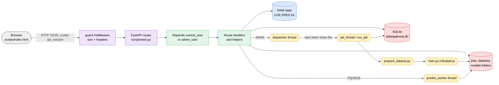

# Architecture

## The parts

## How a click travels

1. The page (`scripts/index.html`, plain JavaScript) calls `api(path, method, body)`: `fetch` with the cookie. It also polls `GET /api/jobs` every 3 seconds.
2. uvicorn gives the request to the FastAPI `app` in `scripts/web.py`. The `guard()` middleware first refuses an anonymous or oversized upload (401 / 413) and later adds the security headers.
3. The route runs its dependency: `current_user` (401 without a valid cookie) or `admin_user` (403 for a normal user). Ownership checks (`own_job`, `own_pred`, `own_dataset`) follow inside the handler.
4. The handler validates input (a wrong value gives a 4xx with a message the page shows as is) and calls helpers or functions from the [[Function Catalog]].
5. State is read or written in SQLite through `sql()` / `sql_n()` (one shared connection with a lock, autocommit), on disk in the job and dataset folders, or in RAM dictionaries.
6. The answer is JSON (or a file). The page redraws with its `h()` helper; there is no framework.

## Threads and subprocesses

| What | Started by | Does |
|---|---|---|
| dispatcher thread | `startup()` | every 3 s or when woken: starts the oldest queued jobs while the shares fit in 100 |
| job thread (one per running job) | dispatcher | run_job: `prepare_dataset.py` then `train.py` as subprocesses, copies their output into `log.txt`, parses progress |
| predict worker thread | `startup()` | runs queued predictions one by one (CPU by default) |
| notify thread | `finish()` / cancel | email and Teams, never blocks the queue |
| download thread | Admin > Models > Download | fetches one `.pt` into `models/` |

Environment passed to the subprocesses: `YOLO_CONFIG` (the job's own `config.yaml`) and `YOLO_SHARE` (percent of CPU threads, RAM and GPU memory the job may use).

## Roles

| | user | admin |
|---|---|---|
| Queue | sees all jobs | sees all jobs |
| Start a training | max 2 waiting or running | unlimited |
| Job log, charts, Predict, Download, Cancel | own jobs | all jobs |
| Delete a finished job | no | yes |
| Datasets | own | all |
| Users, Models, Server load, Notifications | no | yes |

## Configuration

| File | Holds |
|---|---|
| `configuration/web.yaml` | port, upload limits, jobs per user, keep days, predict limits, starting model list |
| `configuration/config.yaml` | the training settings every job copies (same keys as the desktop app) |
| `settings` table | what the admin saves in the page: SMTP, Teams, share per job, allowed models |
| `jobs/<id>/config.yaml` | the settings of one job, frozen at submit |

## Where the code is

| Part | File |
|---|---|
| Web server, API, queue, predict, notifications | `scripts/web.py` |
| Hardware auto-detect, dataset split, helpers shared with the desktop app | `scripts/core.py` |
| Training steps | `scripts/prepare_dataset.py`, `scripts/train.py` |
| The page | `scripts/index.html` |
| Start | `app.py`, `00.Setup_env.ps1` |
| Self-check | `scripts/test_web.py` |
