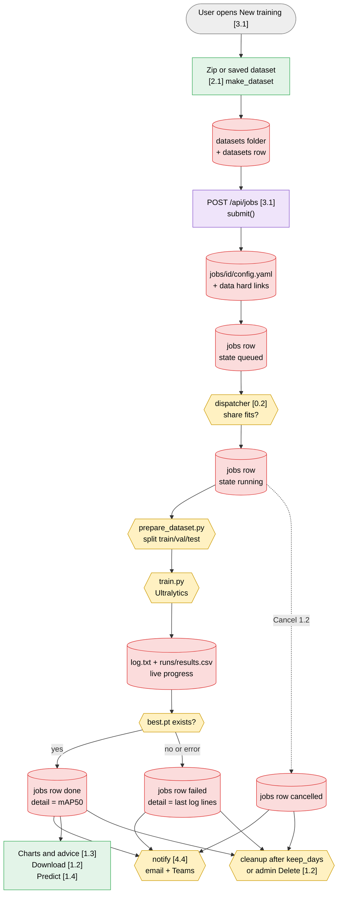

# End-to-End Flow

The life of one training, from the upload to the cleanup. Numbers in brackets point to the menu notes.

## What hands data to the next step

| From | To | Through |
|---|---|---|
| Upload ([[2.1 Datasets]]) | Training ([[3.1 New training]]) | `datasets/<id>/` hard-linked into `jobs/<id>/data/` |
| Form values ([[3.1 New training]]) | `prepare_dataset.py`, `train.py` | `jobs/<id>/config.yaml` (env `YOLO_CONFIG`) |
| `prepare_dataset.py` | `train.py` | `data/dataset/{train,val,test}` and `dataset.yaml` |
| `train.py` | Charts ([[1.3 Results charts and advice]]) | `runs/<run>/results.csv` |
| `train.py` | Predict ([[1.4 Predict]]), Download ([[1.2 Job detail]]) | `runs/<run>/weights/best.pt` |
| Job end | Notifications ([[4.4 Notifications]]) | `jobs` row (state, detail) read by `notify()` |
| Server load ([[4.3 Server load]]) | Dispatcher | `settings.job_share`, read when the next job starts |
| Models ([[4.2 Models]]) | New training | `settings.models` list and `models/*.pt` files |

## States of a job

| State | Set by | Next |
|---|---|---|
| queued | `submit()` | running (dispatcher) or cancelled |
| running | `run_job()` | done, failed or cancelled; failed by `startup()` if the server restarts |
| done | `finish()` when `best.pt` exists | deleted after `keep_days` or by admin |
| failed | `finish()` on a non-zero exit, missing best.pt, gateway error or restart | same |
| cancelled | `cancel()` (queued) or `run_job()` after the kill (running) | same |
