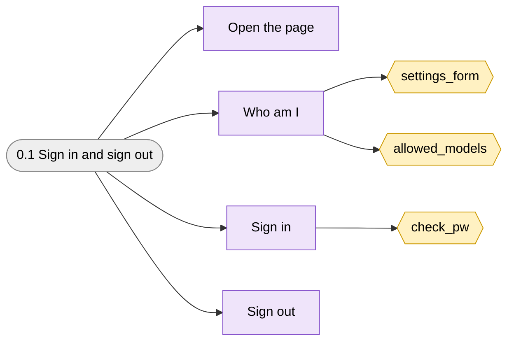
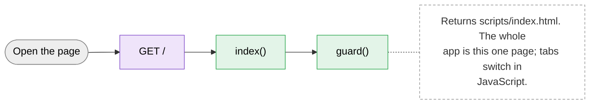
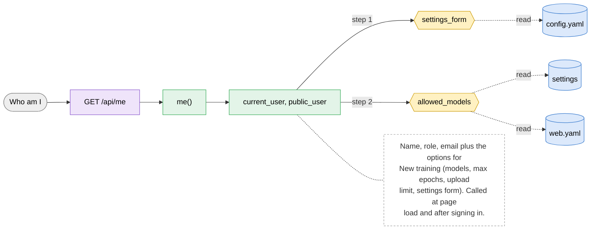
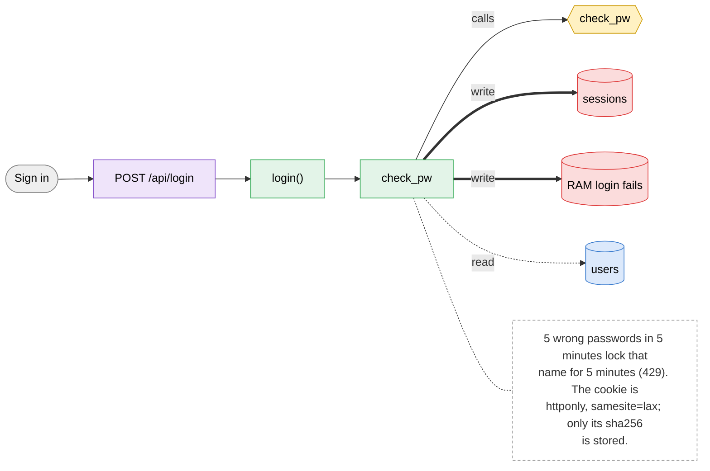
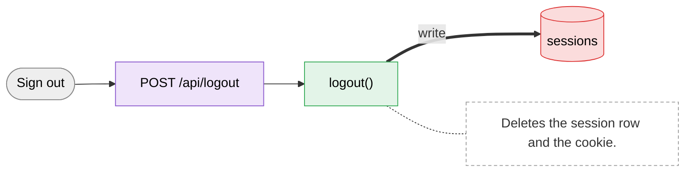

# 0.1 Sign in and sign out

> [!abstract] What it does
> Cookie sign-in. A user name and password give a `gw_session` cookie (12 hours). Every API route checks it; the page shows the login form again on a 401.

## Where to look (quick answer)

| Item | Value |
|---|---|
| Section | System |
| Screen | login page (one page at `/`, tabs switch in JavaScript) |
| Routes | `GET /` `GET /api/me` `POST /api/login` `POST /api/logout` |
| Handlers | `index()`, `me()`, `login()`, `logout()` (in `scripts/web.py` unless noted) |
| Functions / steps | [[Function Catalog#settings_form\|settings_form]], [[Function Catalog#allowed_models\|allowed_models]], [[Function Catalog#check_pw\|check_pw]] |
| Stores written | [[Table Catalog#sessions\|sessions]], [[Table Catalog#RAM login fails\|RAM login fails]] |
| Stores read | [[Table Catalog#config.yaml\|config.yaml]], [[Table Catalog#settings\|settings]], [[Table Catalog#web.yaml\|web.yaml]], [[Table Catalog#users\|users]] |

## Action map: button -> route -> Python -> function -> stores

| Action | HTTP route | Handler | Helpers | Function / step | Stores (R: / **W:**) | Notes |
|---|---|---|---|---|---|---|
| Open the page | `GET /` | `index()` | guard() | - | - | Returns `scripts/index.html`. The whole app is this one page; tabs switch in JavaScript. |
| Who am I | `GET /api/me` | `me()` | current_user, public_user | [[Function Catalog#settings_form\|settings_form]] [[Function Catalog#allowed_models\|allowed_models]] | R: [[Table Catalog#config.yaml\|config.yaml]], [[Table Catalog#settings\|settings]], [[Table Catalog#web.yaml\|web.yaml]] | Name, role, email plus the options for New training (models, max epochs, upload limit, settings form). Called at page load and after signing in. |
| Sign in | `POST /api/login` | `login()` | check_pw | [[Function Catalog#check_pw\|check_pw]] **Inline SQL / files in handler** | R: [[Table Catalog#users\|users]] **W:** [[Table Catalog#sessions\|sessions]], [[Table Catalog#RAM login fails\|RAM login fails]] | 5 wrong passwords in 5 minutes lock that name for 5 minutes (429). The cookie is httponly, samesite=lax; only its sha256 is stored. |
| Sign out | `POST /api/logout` | `logout()` | - | -**Inline SQL / files in handler** | **W:** [[Table Catalog#sessions\|sessions]] | Deletes the session row and the cookie. |

_Stores = taken from the function catalog plus the SQL/file access written directly in the handler. **W** = written, R = read only. A route that says `background` is not clicked: a server thread runs it._

## Flow chart

> [!tip] How to read
> Left to right: **user action** (grey) -> **route** (purple) -> **Python handler / helper** (green) -> **function or step** (yellow, hexagon) -> **store** (cylinder: SQLite table, folder, config file or RAM). Red thick arrow = it writes the store, blue dotted arrow = it only reads. The dashed box is a note from the action map. Details of every box are in the tables above.

### Overview of 0.1 Sign in and sign out

### 1. Open the page

### 2. Who am I

### 3. Sign in

### 4. Sign out

## Files

- `scripts/web.py` (login, logout, me, guard, user_from_cookie)
- `scripts/index.html` (showLogin, start)

Base path: `vision-web-gateway/` in this repo.

## Functions and stores

**Functions / steps:** [[Function Catalog#settings_form|settings_form]], [[Function Catalog#allowed_models|allowed_models]], [[Function Catalog#check_pw|check_pw]]

**Stores:** [[Table Catalog#sessions|sessions]] (W), [[Table Catalog#RAM login fails|RAM login fails]] (W), [[Table Catalog#config.yaml|config.yaml]], [[Table Catalog#settings|settings]], [[Table Catalog#web.yaml|web.yaml]], [[Table Catalog#users|users]]

## If something goes wrong

| Symptom | Check |
|---|---|
| `wrong name or password` | Name or password typed wrong, or the user is deactivated (Admin > Users, Active). |
| `too many wrong passwords, wait 5 minutes` | 5 failures in 5 minutes. The lock is in RAM: restarting `app.py` clears it. |
| Page keeps returning to the login form | Cookie expired (12 h), the user was deactivated, or the browser blocks cookies for this address. |
| Forgot the admin password | Delete the admin row (or all users) in `data/gateway.db` while the server is stopped: the next start creates a new admin and prints the password. Do this only on the server. |

General checklist: [[Troubleshooting Guide]] (job log, server console, database).

## Related menus

- [[0.2 Background workers|0.2 Background workers]]
- [[5.1 Account|5.1 Account]]
- [[4.1 Users|4.1 Users]]
