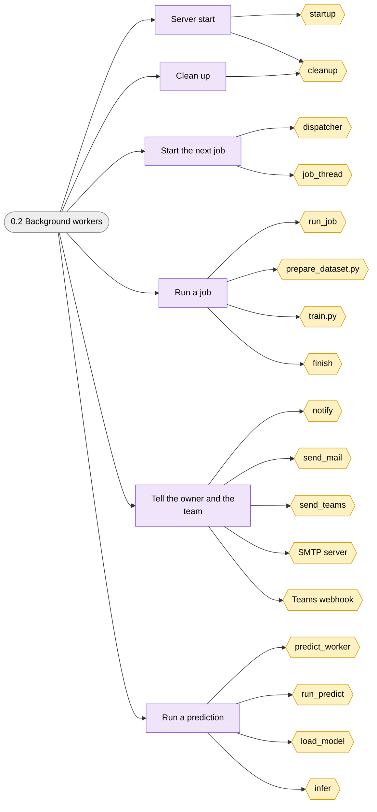
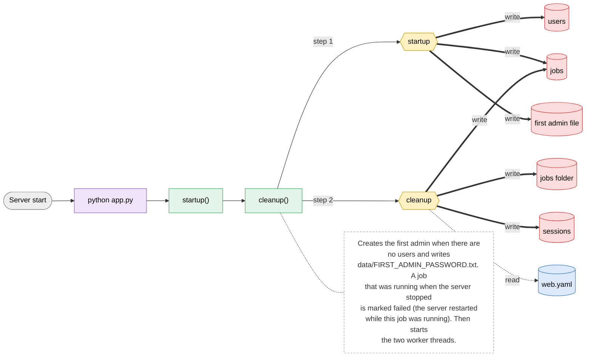
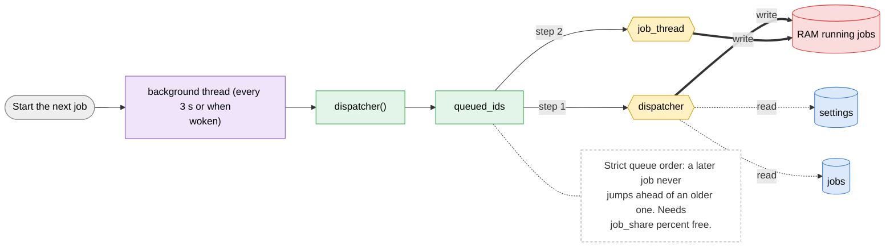
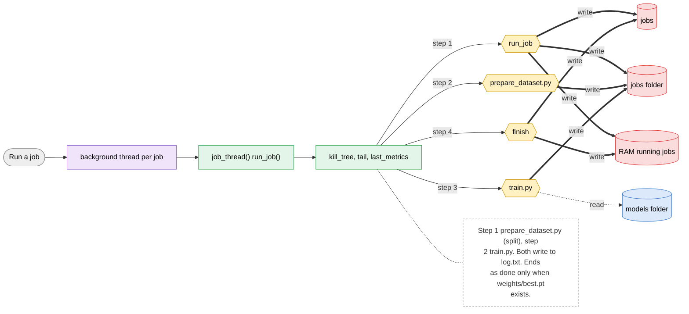
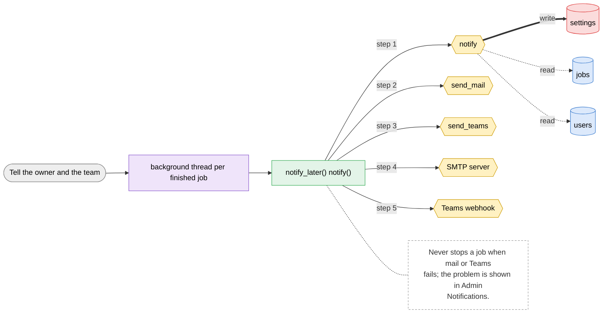
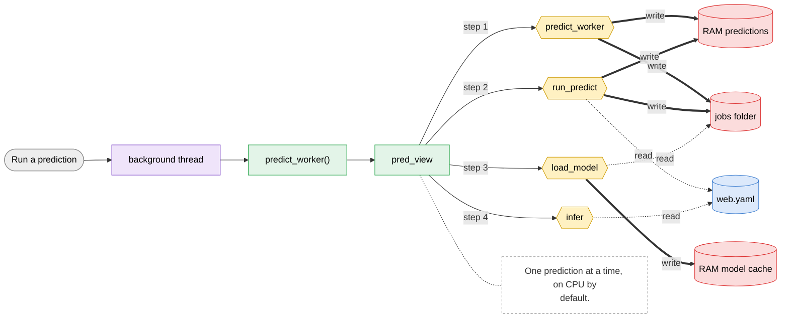
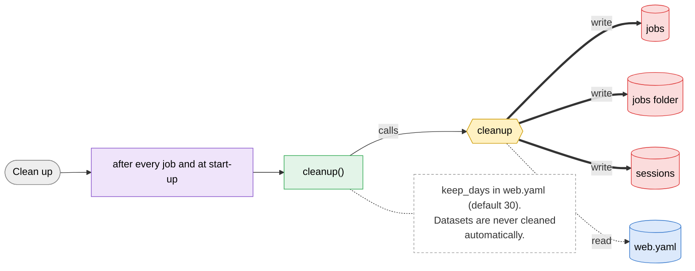

# 0.2 Background workers

> [!abstract] What it does
> What the server does by itself, without a click: start-up, the dispatcher that starts queued jobs, the job runner that launches `prepare_dataset.py` and `train.py`, notifications, the predict worker and cleanup. Everything the other menus queue ends up here.

## Where to look (quick answer)

| Item | Value |
|---|---|
| Section | System |
| Screen | none (hidden: runs inside the server, no screen) (one page at `/`, tabs switch in JavaScript) |
| Routes | `python app.py` `background thread (every 3 s or when woken)` `background thread per job` `background thread per finished job` `background thread` `after every job and at start-up` |
| Handlers | `startup()`, `dispatcher()`, `job_thread() > run_job()`, `notify_later() > notify()`, `predict_worker()`, `cleanup()` (in `scripts/web.py` unless noted) |
| Functions / steps | [[Function Catalog#startup\|startup]], [[Function Catalog#cleanup\|cleanup]], [[Function Catalog#dispatcher\|dispatcher]], [[Function Catalog#job_thread\|job_thread]], [[Function Catalog#run_job\|run_job]], [[Function Catalog#prepare_dataset.py\|prepare_dataset.py]], [[Function Catalog#train.py\|train.py]], [[Function Catalog#finish\|finish]], [[Function Catalog#notify\|notify]], [[Function Catalog#send_mail\|send_mail]], [[Function Catalog#send_teams\|send_teams]], [[Function Catalog#SMTP server\|SMTP server]], [[Function Catalog#Teams webhook\|Teams webhook]], [[Function Catalog#predict_worker\|predict_worker]], [[Function Catalog#run_predict\|run_predict]], [[Function Catalog#load_model\|load_model]], [[Function Catalog#infer\|infer]] |
| Stores written | [[Table Catalog#users\|users]], [[Table Catalog#jobs\|jobs]], [[Table Catalog#first admin file\|first admin file]], [[Table Catalog#jobs folder\|jobs folder]], [[Table Catalog#sessions\|sessions]], [[Table Catalog#RAM running jobs\|RAM running jobs]], [[Table Catalog#settings\|settings]], [[Table Catalog#RAM predictions\|RAM predictions]], [[Table Catalog#RAM model cache\|RAM model cache]] |
| Stores read | [[Table Catalog#web.yaml\|web.yaml]], [[Table Catalog#models folder\|models folder]] |

## Action map: button -> route -> Python -> function -> stores

| Action | HTTP route | Handler | Helpers | Function / step | Stores (R: / **W:**) | Notes |
|---|---|---|---|---|---|---|
| Server start | `python app.py` | `startup()` | cleanup() | [[Function Catalog#startup\|startup]] [[Function Catalog#cleanup\|cleanup]] | R: [[Table Catalog#web.yaml\|web.yaml]] **W:** [[Table Catalog#users\|users]], [[Table Catalog#jobs\|jobs]], [[Table Catalog#first admin file\|first admin file]], [[Table Catalog#jobs folder\|jobs folder]], [[Table Catalog#sessions\|sessions]] | Creates the first admin when there are no users and writes `data/FIRST_ADMIN_PASSWORD.txt`. A job that was running when the server stopped is marked failed (`the server restarted while this job was running`). Then starts the two worker threads. |
| Start the next job | `background thread (every 3 s or when woken)` | `dispatcher()` | queued_ids | [[Function Catalog#dispatcher\|dispatcher]] [[Function Catalog#job_thread\|job_thread]] | R: [[Table Catalog#settings\|settings]], [[Table Catalog#jobs\|jobs]] **W:** [[Table Catalog#RAM running jobs\|RAM running jobs]] | Strict queue order: a later job never jumps ahead of an older one. Needs `job_share` percent free. |
| Run a job | `background thread per job` | `job_thread() > run_job()` | kill_tree, tail, last_metrics | [[Function Catalog#run_job\|run_job]] [[Function Catalog#prepare_dataset.py\|prepare_dataset.py]] [[Function Catalog#train.py\|train.py]] [[Function Catalog#finish\|finish]] | R: [[Table Catalog#models folder\|models folder]] **W:** [[Table Catalog#jobs\|jobs]], [[Table Catalog#jobs folder\|jobs folder]], [[Table Catalog#RAM running jobs\|RAM running jobs]] | Step 1 `prepare_dataset.py` (split), step 2 `train.py`. Both write to `log.txt`. Ends as done only when `weights/best.pt` exists. |
| Tell the owner and the team | `background thread per finished job` | `notify_later() > notify()` | - | [[Function Catalog#notify\|notify]] [[Function Catalog#send_mail\|send_mail]] [[Function Catalog#send_teams\|send_teams]] [[Function Catalog#SMTP server\|SMTP server]] [[Function Catalog#Teams webhook\|Teams webhook]] | R: [[Table Catalog#jobs\|jobs]], [[Table Catalog#users\|users]] **W:** [[Table Catalog#settings\|settings]] | Never stops a job when mail or Teams fails; the problem is shown in Admin > Notifications. |
| Run a prediction | `background thread` | `predict_worker()` | pred_view | [[Function Catalog#predict_worker\|predict_worker]] [[Function Catalog#run_predict\|run_predict]] [[Function Catalog#load_model\|load_model]] [[Function Catalog#infer\|infer]] | R: [[Table Catalog#web.yaml\|web.yaml]] **W:** [[Table Catalog#RAM predictions\|RAM predictions]], [[Table Catalog#jobs folder\|jobs folder]], [[Table Catalog#RAM model cache\|RAM model cache]] | One prediction at a time, on CPU by default. |
| Clean up | `after every job and at start-up` | `cleanup()` | - | [[Function Catalog#cleanup\|cleanup]] | R: [[Table Catalog#web.yaml\|web.yaml]] **W:** [[Table Catalog#jobs\|jobs]], [[Table Catalog#jobs folder\|jobs folder]], [[Table Catalog#sessions\|sessions]] | `keep_days` in web.yaml (default 30). Datasets are never cleaned automatically. |

_Stores = taken from the function catalog plus the SQL/file access written directly in the handler. **W** = written, R = read only. A route that says `background` is not clicked: a server thread runs it._

## Flow chart

> [!tip] How to read
> Left to right: **user action** (grey) -> **route** (purple) -> **Python handler / helper** (green) -> **function or step** (yellow, hexagon) -> **store** (cylinder: SQLite table, folder, config file or RAM). Red thick arrow = it writes the store, blue dotted arrow = it only reads. The dashed box is a note from the action map. Details of every box are in the tables above.

### Overview of 0.2 Background workers

### 1. Server start

### 2. Start the next job

### 3. Run a job

### 4. Tell the owner and the team

### 5. Run a prediction

### 6. Clean up

## Files

- `scripts/web.py` (startup, dispatcher, job_thread, run_job, finish, notify, predict_worker, cleanup)
- `scripts/core.py`, `scripts/prepare_dataset.py`, `scripts/train.py`
- `app.py` (starts uvicorn)

Base path: `vision-web-gateway/` in this repo.

## Functions and stores

**Functions / steps:** [[Function Catalog#startup|startup]], [[Function Catalog#cleanup|cleanup]], [[Function Catalog#dispatcher|dispatcher]], [[Function Catalog#job_thread|job_thread]], [[Function Catalog#run_job|run_job]], [[Function Catalog#prepare_dataset.py|prepare_dataset.py]], [[Function Catalog#train.py|train.py]], [[Function Catalog#finish|finish]], [[Function Catalog#notify|notify]], [[Function Catalog#send_mail|send_mail]], [[Function Catalog#send_teams|send_teams]], [[Function Catalog#SMTP server|SMTP server]], [[Function Catalog#Teams webhook|Teams webhook]], [[Function Catalog#predict_worker|predict_worker]], [[Function Catalog#run_predict|run_predict]], [[Function Catalog#load_model|load_model]], [[Function Catalog#infer|infer]]

**Stores:** [[Table Catalog#users|users]] (W), [[Table Catalog#jobs|jobs]] (W), [[Table Catalog#first admin file|first admin file]] (W), [[Table Catalog#jobs folder|jobs folder]] (W), [[Table Catalog#sessions|sessions]] (W), [[Table Catalog#RAM running jobs|RAM running jobs]] (W), [[Table Catalog#settings|settings]] (W), [[Table Catalog#RAM predictions|RAM predictions]] (W), [[Table Catalog#RAM model cache|RAM model cache]] (W), [[Table Catalog#web.yaml|web.yaml]], [[Table Catalog#models folder|models folder]]

## If something goes wrong

| Symptom | Check |
|---|---|
| Job stays `queued` forever | The server has to be running `app.py` (the dispatcher is a thread inside it). Another job may be running: with `job_share` 100 only one runs at a time. Check Admin > Server load. |
| Job fails in seconds with `Download failure ... SSLCertVerificationError` | The model `.pt` is not in `models/` and the auto-download hit a company proxy that re-signs HTTPS. Copy the file into `models/` by hand or fix the certificate (see [[Troubleshooting Guide]]). |
| `the server restarted while this job was running` | `app.py` was stopped or the PC rebooted during training. Start a new job; keep it running with Task Scheduler. |
| `training ended without a best.pt` | Training stopped before the first epoch finished (or was killed). Read `jobs/<id>/log.txt`. |
| `CUDA out of memory` in the log | Batch too big for the share or GPU. Lower Batch in Training settings, use a smaller model, or lower the share per job. |
| Notification did not arrive | Admin > Notifications shows the last error; press Test email / Test Teams. |

General checklist: [[Troubleshooting Guide]] (job log, server console, database).

## Related menus

- [[3.1 New training|3.1 New training]]
- [[1.2 Job detail|1.2 Job detail]]
- [[4.3 Server load|4.3 Server load]]
- [[4.4 Notifications|4.4 Notifications]]
- [[1.4 Predict|1.4 Predict]]
