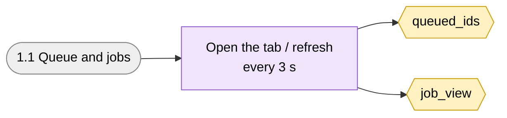
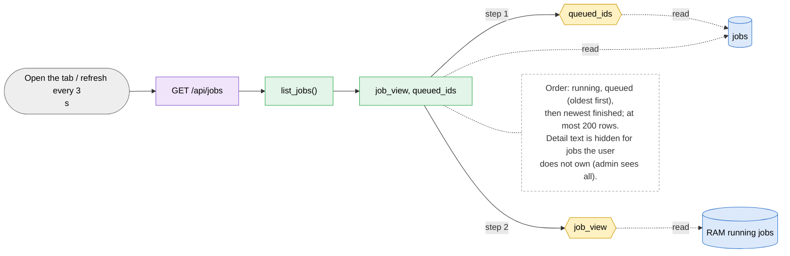

# 1.1 Queue and jobs

> [!abstract] What it does
> The first tab. Every signed-in user sees every job (who, model, state, progress, ETA, submitted). The list refreshes every 3 seconds. Click a row to open the job detail (1.2).

## Where to look (quick answer)

| Item | Value |
|---|---|
| Section | Queue |
| Screen | Queue and jobs (one page at `/`, tabs switch in JavaScript) |
| Routes | `GET /api/jobs` |
| Handlers | `list_jobs()` (in `scripts/web.py` unless noted) |
| Functions / steps | [[Function Catalog#queued_ids\|queued_ids]], [[Function Catalog#job_view\|job_view]] |
| Stores written | - |
| Stores read | [[Table Catalog#jobs\|jobs]], [[Table Catalog#RAM running jobs\|RAM running jobs]] |

## Action map: button -> route -> Python -> function -> stores

| Action | HTTP route | Handler | Helpers | Function / step | Stores (R: / **W:**) | Notes |
|---|---|---|---|---|---|---|
| Open the tab / refresh every 3 s | `GET /api/jobs` | `list_jobs()` | job_view, queued_ids | [[Function Catalog#queued_ids\|queued_ids]] [[Function Catalog#job_view\|job_view]] **Inline SQL / files in handler** | R: [[Table Catalog#jobs\|jobs]], [[Table Catalog#RAM running jobs\|RAM running jobs]] | Order: running, queued (oldest first), then newest finished; at most 200 rows. Detail text is hidden for jobs the user does not own (admin sees all). |

_Stores = taken from the function catalog plus the SQL/file access written directly in the handler. **W** = written, R = read only. A route that says `background` is not clicked: a server thread runs it._

## Flow chart

> [!tip] How to read
> Left to right: **user action** (grey) -> **route** (purple) -> **Python handler / helper** (green) -> **function or step** (yellow, hexagon) -> **store** (cylinder: SQLite table, folder, config file or RAM). Red thick arrow = it writes the store, blue dotted arrow = it only reads. The dashed box is a note from the action map. Details of every box are in the tables above.

### Overview of 1.1 Queue and jobs

### 1. Open the tab / refresh every 3 s

## Files

- `scripts/web.py` (list_jobs, job_view, queued_ids)
- `scripts/index.html` (poll, renderJobs)

Base path: `vision-web-gateway/` in this repo.

## Functions and stores

**Functions / steps:** [[Function Catalog#queued_ids|queued_ids]], [[Function Catalog#job_view|job_view]]

**Stores:** [[Table Catalog#jobs|jobs]], [[Table Catalog#RAM running jobs|RAM running jobs]]

## If something goes wrong

| Symptom | Check |
|---|---|
| List empty but jobs exist | The row limit is 200; older finished jobs fall off the list but stay on disk until `keep_days`. |
| Progress stays at `starting...` | The job is preparing the dataset or loading the model; the first epoch line has not arrived. Open the job and read the log. |
| ETA looks too long / missing | ETA is counted from the first training progress line, so it appears after the first batches. |

General checklist: [[Troubleshooting Guide]] (job log, server console, database).

## Related menus

- [[1.2 Job detail|1.2 Job detail]]
- [[3.1 New training|3.1 New training]]
