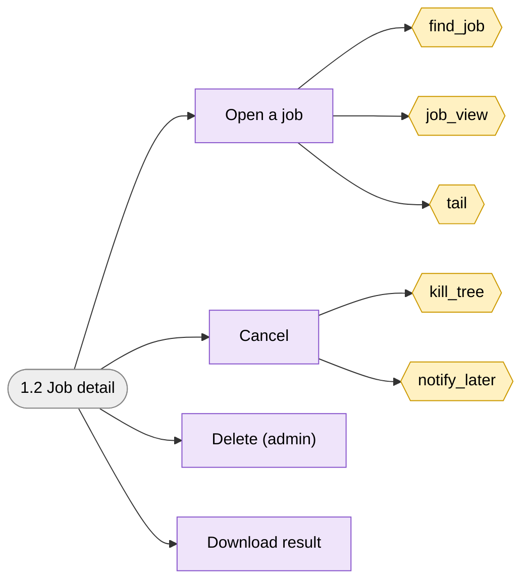
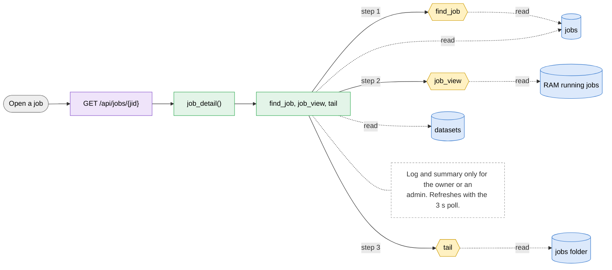
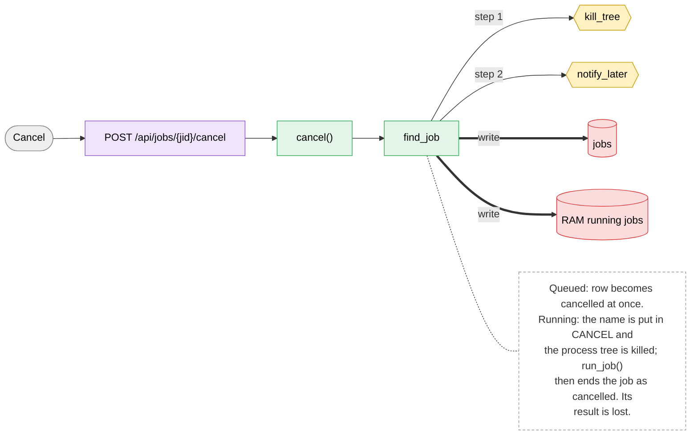
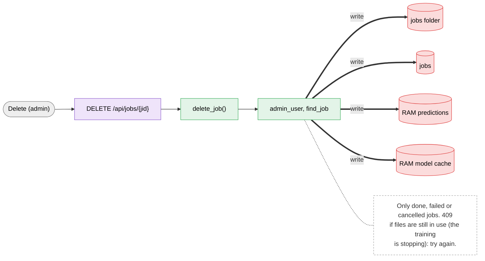
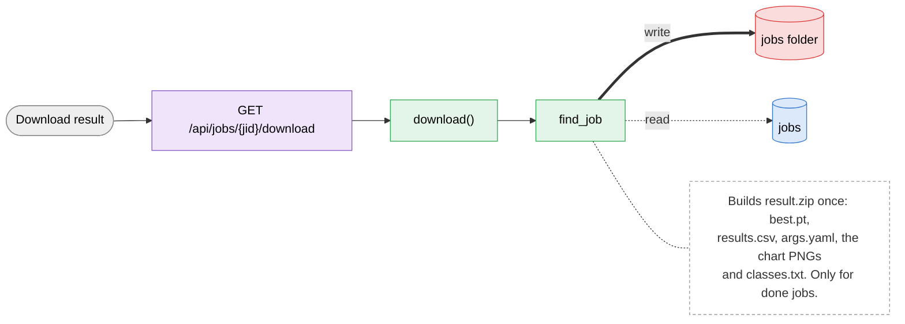

# 1.2 Job detail

> [!abstract] What it does
> Everything about one job: dataset summary, training log (last 40 lines), and the buttons Cancel (owner or admin), Delete (admin, finished jobs only) and Download result (done jobs, owner or admin).

## Where to look (quick answer)

| Item | Value |
|---|---|
| Section | Queue |
| Screen | Queue and jobs (click a row) (one page at `/`, tabs switch in JavaScript) |
| Routes | `GET /api/jobs/{jid}` `POST /api/jobs/{jid}/cancel` `DELETE /api/jobs/{jid}` `GET /api/jobs/{jid}/download` |
| Handlers | `job_detail()`, `cancel()`, `delete_job()`, `download()` (in `scripts/web.py` unless noted) |
| Functions / steps | [[Function Catalog#find_job\|find_job]], [[Function Catalog#job_view\|job_view]], [[Function Catalog#tail\|tail]], [[Function Catalog#kill_tree\|kill_tree]], [[Function Catalog#notify_later\|notify_later]] |
| Stores written | [[Table Catalog#jobs\|jobs]], [[Table Catalog#RAM running jobs\|RAM running jobs]], [[Table Catalog#jobs folder\|jobs folder]], [[Table Catalog#RAM predictions\|RAM predictions]], [[Table Catalog#RAM model cache\|RAM model cache]] |
| Stores read | [[Table Catalog#datasets\|datasets]] |

## Action map: button -> route -> Python -> function -> stores

| Action | HTTP route | Handler | Helpers | Function / step | Stores (R: / **W:**) | Notes |
|---|---|---|---|---|---|---|
| Open a job | `GET /api/jobs/{jid}` | `job_detail()` | find_job, job_view, tail | [[Function Catalog#find_job\|find_job]] [[Function Catalog#job_view\|job_view]] [[Function Catalog#tail\|tail]] **Inline SQL / files in handler** | R: [[Table Catalog#jobs\|jobs]], [[Table Catalog#RAM running jobs\|RAM running jobs]], [[Table Catalog#jobs folder\|jobs folder]], [[Table Catalog#datasets\|datasets]] | Log and summary only for the owner or an admin. Refreshes with the 3 s poll. |
| Cancel | `POST /api/jobs/{jid}/cancel` | `cancel()` | find_job | [[Function Catalog#kill_tree\|kill_tree]] [[Function Catalog#notify_later\|notify_later]] **Inline SQL / files in handler** | **W:** [[Table Catalog#jobs\|jobs]], [[Table Catalog#RAM running jobs\|RAM running jobs]] | Queued: row becomes cancelled at once. Running: the name is put in CANCEL and the process tree is killed; run_job() then ends the job as cancelled. Its result is lost. |
| Delete (admin) | `DELETE /api/jobs/{jid}` | `delete_job()` | admin_user, find_job | -**Inline SQL / files in handler** | **W:** [[Table Catalog#jobs folder\|jobs folder]], [[Table Catalog#jobs\|jobs]], [[Table Catalog#RAM predictions\|RAM predictions]], [[Table Catalog#RAM model cache\|RAM model cache]] | Only done, failed or cancelled jobs. 409 if files are still in use (the training is stopping): try again. |
| Download result | `GET /api/jobs/{jid}/download` | `download()` | find_job | -**Inline SQL / files in handler** | R: [[Table Catalog#jobs\|jobs]] **W:** [[Table Catalog#jobs folder\|jobs folder]] | Builds `result.zip` once: best.pt, results.csv, args.yaml, the chart PNGs and classes.txt. Only for done jobs. |

_Stores = taken from the function catalog plus the SQL/file access written directly in the handler. **W** = written, R = read only. A route that says `background` is not clicked: a server thread runs it._

## Flow chart

> [!tip] How to read
> Left to right: **user action** (grey) -> **route** (purple) -> **Python handler / helper** (green) -> **function or step** (yellow, hexagon) -> **store** (cylinder: SQLite table, folder, config file or RAM). Red thick arrow = it writes the store, blue dotted arrow = it only reads. The dashed box is a note from the action map. Details of every box are in the tables above.

### Overview of 1.2 Job detail

### 1. Open a job

### 2. Cancel

### 3. Delete (admin)

### 4. Download result

## Files

- `scripts/web.py` (job_detail, cancel, delete_job, download)
- `scripts/index.html` (renderDetail)

Base path: `vision-web-gateway/` in this repo.

## Functions and stores

**Functions / steps:** [[Function Catalog#find_job|find_job]], [[Function Catalog#job_view|job_view]], [[Function Catalog#tail|tail]], [[Function Catalog#kill_tree|kill_tree]], [[Function Catalog#notify_later|notify_later]]

**Stores:** [[Table Catalog#jobs|jobs]] (W), [[Table Catalog#RAM running jobs|RAM running jobs]] (W), [[Table Catalog#jobs folder|jobs folder]] (W), [[Table Catalog#RAM predictions|RAM predictions]] (W), [[Table Catalog#RAM model cache|RAM model cache]] (W), [[Table Catalog#datasets|datasets]]

## If something goes wrong

| Symptom | Check |
|---|---|
| `you can only cancel your own jobs` / `...download your own results` | 403: the job belongs to another user. Admin can do both. |
| `this job is already finished` when cancelling | The job ended between the click and the request. |
| Delete answers 409 `some files are still in use` | Training files are still locked right after a cancel. Wait a moment and press Delete again. |
| Download answers `this job has no result` | Only state `done` has one. |

General checklist: [[Troubleshooting Guide]] (job log, server console, database).

## Related menus

- [[1.1 Queue and jobs|1.1 Queue and jobs]]
- [[1.3 Results charts and advice|1.3 Results charts and advice]]
- [[1.4 Predict|1.4 Predict]]
- [[0.2 Background workers|0.2 Background workers]]
