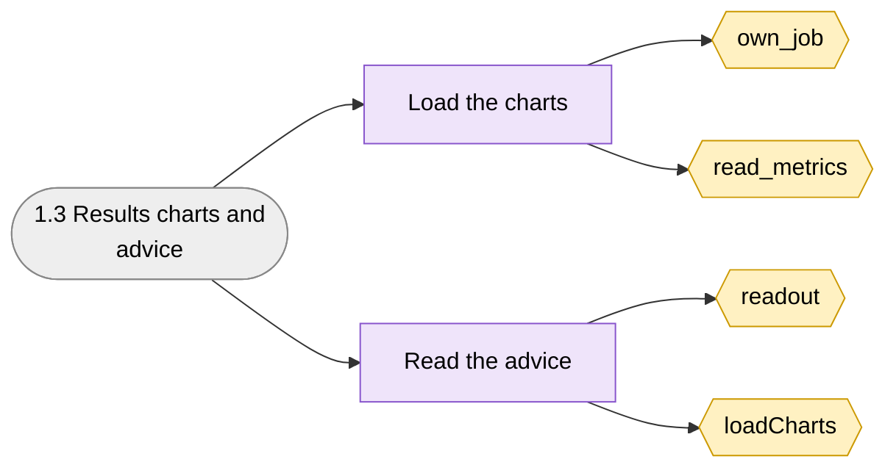
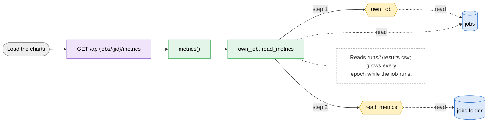
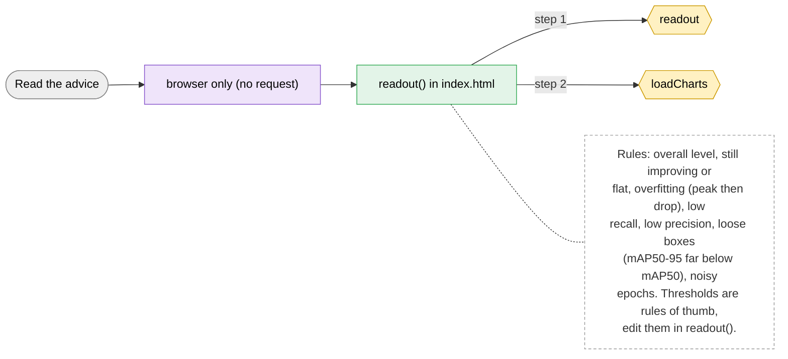

# 1.3 Results charts and advice

> [!abstract] What it does
> Per-epoch numbers of the validation images: precision, recall, mAP50, mAP50-95, miss ratio and false-alarm ratio, as tiles and three line charts. Under them, **What this means** explains the numbers and what to try. If a Target mAP50 was set in New training, advice appears only when the finished job stayed below it.

## Where to look (quick answer)

| Item | Value |
|---|---|
| Section | Queue |
| Screen | Queue and jobs (below the job detail) (one page at `/`, tabs switch in JavaScript) |
| Routes | `GET /api/jobs/{jid}/metrics` `browser only (no request)` |
| Handlers | `metrics()`, `readout() in index.html` (in `scripts/web.py` unless noted) |
| Functions / steps | [[Function Catalog#own_job\|own_job]], [[Function Catalog#read_metrics\|read_metrics]], [[Function Catalog#readout\|readout]], [[Function Catalog#loadCharts\|loadCharts]] |
| Stores written | - |
| Stores read | [[Table Catalog#jobs\|jobs]], [[Table Catalog#jobs folder\|jobs folder]] |

## Action map: button -> route -> Python -> function -> stores

| Action | HTTP route | Handler | Helpers | Function / step | Stores (R: / **W:**) | Notes |
|---|---|---|---|---|---|---|
| Load the charts | `GET /api/jobs/{jid}/metrics` | `metrics()` | own_job, read_metrics | [[Function Catalog#own_job\|own_job]] [[Function Catalog#read_metrics\|read_metrics]] **Inline SQL / files in handler** | R: [[Table Catalog#jobs\|jobs]], [[Table Catalog#jobs folder\|jobs folder]] | Reads `runs/*/results.csv`; grows every epoch while the job runs. |
| Read the advice | `browser only (no request)` | `readout() in index.html` | - | [[Function Catalog#readout\|readout]] [[Function Catalog#loadCharts\|loadCharts]] | - | Rules: overall level, still improving or flat, overfitting (peak then drop), low recall, low precision, loose boxes (mAP50-95 far below mAP50), noisy epochs. Thresholds are rules of thumb, edit them in `readout()`. |

_Stores = taken from the function catalog plus the SQL/file access written directly in the handler. **W** = written, R = read only. A route that says `background` is not clicked: a server thread runs it._

## Flow chart

> [!tip] How to read
> Left to right: **user action** (grey) -> **route** (purple) -> **Python handler / helper** (green) -> **function or step** (yellow, hexagon) -> **store** (cylinder: SQLite table, folder, config file or RAM). Red thick arrow = it writes the store, blue dotted arrow = it only reads. The dashed box is a note from the action map. Details of every box are in the tables above.

### Overview of 1.3 Results charts and advice

### 1. Load the charts

### 2. Read the advice

## Files

- `scripts/web.py` (metrics, read_metrics)
- `scripts/index.html` (loadCharts, lineChart, readout)

Base path: `vision-web-gateway/` in this repo.

## Functions and stores

**Functions / steps:** [[Function Catalog#own_job|own_job]], [[Function Catalog#read_metrics|read_metrics]], [[Function Catalog#readout|readout]], [[Function Catalog#loadCharts|loadCharts]]

**Stores:** [[Table Catalog#jobs|jobs]], [[Table Catalog#jobs folder|jobs folder]]

## If something goes wrong

| Symptom | Check |
|---|---|
| `No epoch has finished yet.` | The first epoch is not done, or `results.csv` is not written yet. |
| Charts missing for a failed job | No epoch finished before it failed; read the log. |
| Only `Target reached` is shown, no advice | By design: a Target mAP50 was set and the best epoch reached it. Advice appears only when a finished job stays below the target (stored in `jobs.target`); with no target it is always shown. |

General checklist: [[Troubleshooting Guide]] (job log, server console, database).

## Related menus

- [[1.2 Job detail|1.2 Job detail]]
- [[3.1 New training|3.1 New training]]
