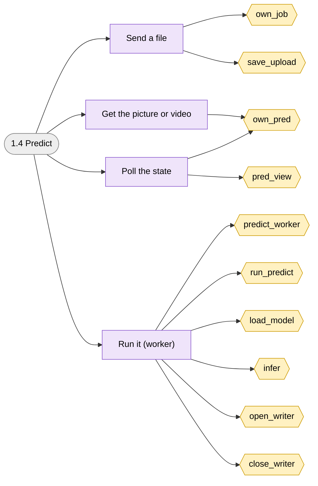
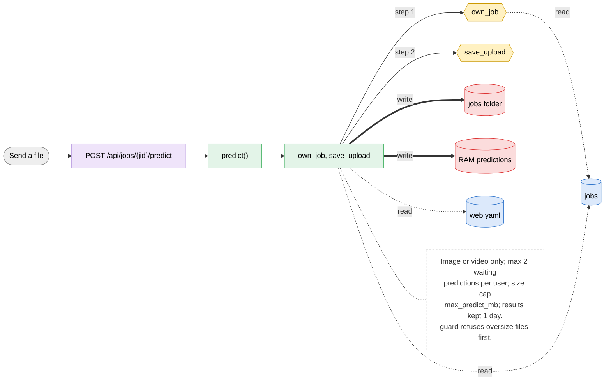
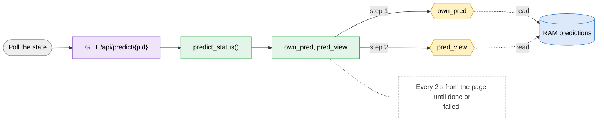
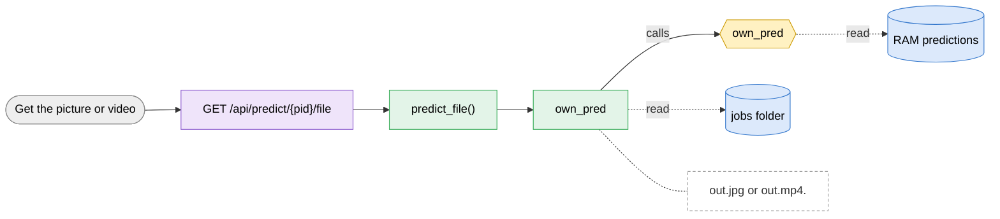
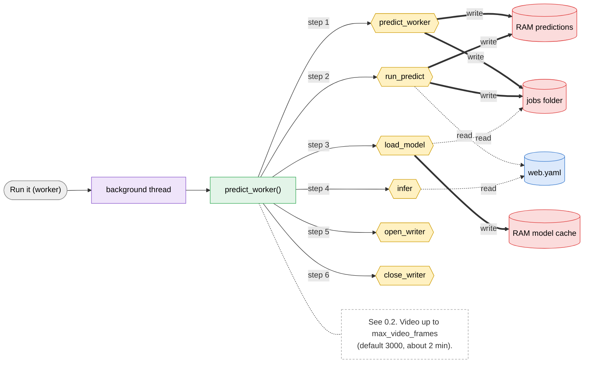

# 1.4 Predict

> [!abstract] What it does
> Send an image or a video to a finished job's `best.pt` and get it back with boxes drawn plus a table of what was found. Runs on the server CPU in its own queue, so it never takes the GPU from a training.

## Where to look (quick answer)

| Item | Value |
|---|---|
| Section | Queue |
| Screen | Queue and jobs (below the charts, done jobs only) (one page at `/`, tabs switch in JavaScript) |
| Routes | `POST /api/jobs/{jid}/predict` `GET /api/predict/{pid}` `GET /api/predict/{pid}/file` `background thread` |
| Handlers | `predict()`, `predict_status()`, `predict_file()`, `predict_worker()` (in `scripts/web.py` unless noted) |
| Functions / steps | [[Function Catalog#own_job\|own_job]], [[Function Catalog#save_upload\|save_upload]], [[Function Catalog#own_pred\|own_pred]], [[Function Catalog#pred_view\|pred_view]], [[Function Catalog#predict_worker\|predict_worker]], [[Function Catalog#run_predict\|run_predict]], [[Function Catalog#load_model\|load_model]], [[Function Catalog#infer\|infer]], [[Function Catalog#open_writer\|open_writer]], [[Function Catalog#close_writer\|close_writer]] |
| Stores written | [[Table Catalog#jobs folder\|jobs folder]], [[Table Catalog#RAM predictions\|RAM predictions]], [[Table Catalog#RAM model cache\|RAM model cache]] |
| Stores read | [[Table Catalog#jobs\|jobs]], [[Table Catalog#web.yaml\|web.yaml]] |

## Action map: button -> route -> Python -> function -> stores

| Action | HTTP route | Handler | Helpers | Function / step | Stores (R: / **W:**) | Notes |
|---|---|---|---|---|---|---|
| Send a file | `POST /api/jobs/{jid}/predict` | `predict()` | own_job, save_upload | [[Function Catalog#own_job\|own_job]] [[Function Catalog#save_upload\|save_upload]] **Inline SQL / files in handler** | R: [[Table Catalog#jobs\|jobs]], [[Table Catalog#web.yaml\|web.yaml]] **W:** [[Table Catalog#jobs folder\|jobs folder]], [[Table Catalog#RAM predictions\|RAM predictions]] | Image or video only; max 2 waiting predictions per user; size cap `max_predict_mb`; results kept 1 day. `guard` refuses oversize files first. |
| Poll the state | `GET /api/predict/{pid}` | `predict_status()` | own_pred, pred_view | [[Function Catalog#own_pred\|own_pred]] [[Function Catalog#pred_view\|pred_view]] | R: [[Table Catalog#RAM predictions\|RAM predictions]] | Every 2 s from the page until done or failed. |
| Get the picture or video | `GET /api/predict/{pid}/file` | `predict_file()` | own_pred | [[Function Catalog#own_pred\|own_pred]] **Inline SQL / files in handler** | R: [[Table Catalog#RAM predictions\|RAM predictions]], [[Table Catalog#jobs folder\|jobs folder]] | `out.jpg` or `out.mp4`. |
| Run it (worker) | `background thread` | `predict_worker()` | - | [[Function Catalog#predict_worker\|predict_worker]] [[Function Catalog#run_predict\|run_predict]] [[Function Catalog#load_model\|load_model]] [[Function Catalog#infer\|infer]] [[Function Catalog#open_writer\|open_writer]] [[Function Catalog#close_writer\|close_writer]] | R: [[Table Catalog#web.yaml\|web.yaml]] **W:** [[Table Catalog#RAM predictions\|RAM predictions]], [[Table Catalog#jobs folder\|jobs folder]], [[Table Catalog#RAM model cache\|RAM model cache]] | See 0.2. Video up to `max_video_frames` (default 3000, about 2 min). |

_Stores = taken from the function catalog plus the SQL/file access written directly in the handler. **W** = written, R = read only. A route that says `background` is not clicked: a server thread runs it._

## Flow chart

> [!tip] How to read
> Left to right: **user action** (grey) -> **route** (purple) -> **Python handler / helper** (green) -> **function or step** (yellow, hexagon) -> **store** (cylinder: SQLite table, folder, config file or RAM). Red thick arrow = it writes the store, blue dotted arrow = it only reads. The dashed box is a note from the action map. Details of every box are in the tables above.

### Overview of 1.4 Predict

### 1. Send a file

### 2. Poll the state

### 3. Get the picture or video

### 4. Run it (worker)

## Files

- `scripts/web.py` (predict, predict_status, predict_file, run_predict, infer, load_model)
- `scripts/index.html` (buildPredict, showPrediction)

Base path: `vision-web-gateway/` in this repo.

## Functions and stores

**Functions / steps:** [[Function Catalog#own_job|own_job]], [[Function Catalog#save_upload|save_upload]], [[Function Catalog#own_pred|own_pred]], [[Function Catalog#pred_view|pred_view]], [[Function Catalog#predict_worker|predict_worker]], [[Function Catalog#run_predict|run_predict]], [[Function Catalog#load_model|load_model]], [[Function Catalog#infer|infer]], [[Function Catalog#open_writer|open_writer]], [[Function Catalog#close_writer|close_writer]]

**Stores:** [[Table Catalog#jobs folder|jobs folder]] (W), [[Table Catalog#RAM predictions|RAM predictions]] (W), [[Table Catalog#RAM model cache|RAM model cache]] (W), [[Table Catalog#jobs|jobs]], [[Table Catalog#web.yaml|web.yaml]]

## If something goes wrong

| Symptom | Check |
|---|---|
| `this job has no trained model (yet)` | Predict needs a job in state `done`. |
| `no such prediction (results are kept for a day)` | Predictions live in RAM: a restart or the 1-day limit removed it. Run it again. |
| `the video has N frames ... the limit is ...` | Cut the video or raise `max_video_frames` in web.yaml. |
| `could not write the result video` | ffmpeg from `imageio-ffmpeg` failed; the message tail is shown. Check the package is installed in `.venv`. |
| Slow | CPU inference (`predict_device: cpu`). Videos take longest. |

General checklist: [[Troubleshooting Guide]] (job log, server console, database).

## Related menus

- [[1.2 Job detail|1.2 Job detail]]
- [[0.2 Background workers|0.2 Background workers]]
