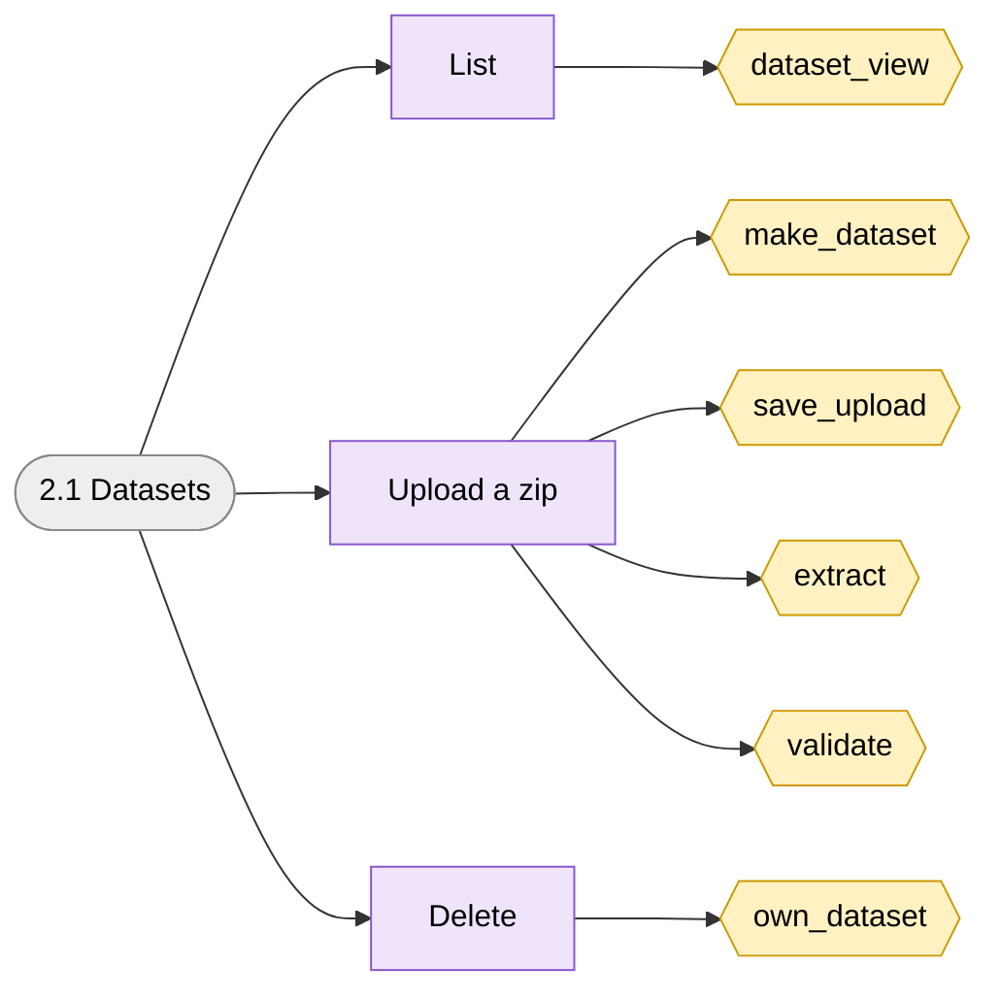
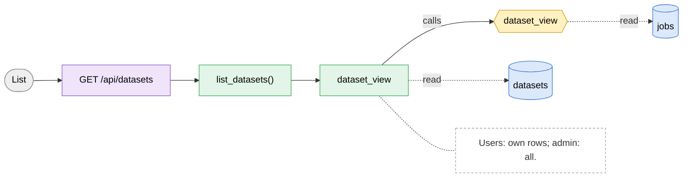
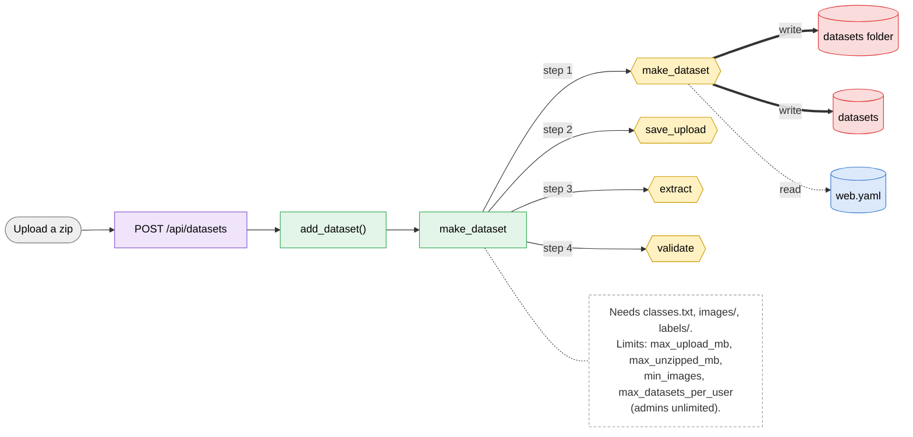
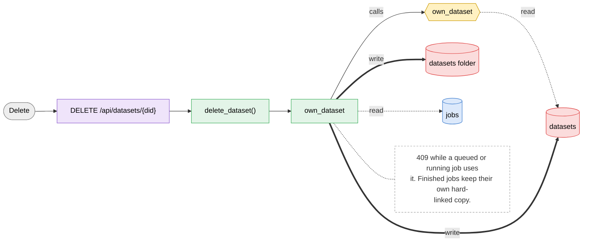

# 2.1 Datasets

> [!abstract] What it does
> Saved dataset zips. Upload once, train any number of times. Users see their own datasets, admins see all (with the size of each). A zip sent with a training is saved here too.

## Where to look (quick answer)

| Item | Value |
|---|---|
| Section | Datasets |
| Screen | Datasets (one page at `/`, tabs switch in JavaScript) |
| Routes | `GET /api/datasets` `POST /api/datasets` `DELETE /api/datasets/{did}` |
| Handlers | `list_datasets()`, `add_dataset()`, `delete_dataset()` (in `scripts/web.py` unless noted) |
| Functions / steps | [[Function Catalog#dataset_view\|dataset_view]], [[Function Catalog#make_dataset\|make_dataset]], [[Function Catalog#save_upload\|save_upload]], [[Function Catalog#extract\|extract]], [[Function Catalog#validate\|validate]], [[Function Catalog#own_dataset\|own_dataset]] |
| Stores written | [[Table Catalog#datasets folder\|datasets folder]], [[Table Catalog#datasets\|datasets]] |
| Stores read | [[Table Catalog#jobs\|jobs]], [[Table Catalog#web.yaml\|web.yaml]] |

## Action map: button -> route -> Python -> function -> stores

| Action | HTTP route | Handler | Helpers | Function / step | Stores (R: / **W:**) | Notes |
|---|---|---|---|---|---|---|
| List | `GET /api/datasets` | `list_datasets()` | dataset_view | [[Function Catalog#dataset_view\|dataset_view]] **Inline SQL / files in handler** | R: [[Table Catalog#jobs\|jobs]], [[Table Catalog#datasets\|datasets]] | Users: own rows; admin: all. |
| Upload a zip | `POST /api/datasets` | `add_dataset()` | make_dataset | [[Function Catalog#make_dataset\|make_dataset]] [[Function Catalog#save_upload\|save_upload]] [[Function Catalog#extract\|extract]] [[Function Catalog#validate\|validate]] | R: [[Table Catalog#web.yaml\|web.yaml]] **W:** [[Table Catalog#datasets folder\|datasets folder]], [[Table Catalog#datasets\|datasets]] | Needs `classes.txt`, `images/`, `labels/`. Limits: `max_upload_mb`, `max_unzipped_mb`, `min_images`, `max_datasets_per_user` (admins unlimited). |
| Delete | `DELETE /api/datasets/{did}` | `delete_dataset()` | own_dataset | [[Function Catalog#own_dataset\|own_dataset]] **Inline SQL / files in handler** | R: [[Table Catalog#jobs\|jobs]] **W:** [[Table Catalog#datasets folder\|datasets folder]], [[Table Catalog#datasets\|datasets]] | 409 while a queued or running job uses it. Finished jobs keep their own hard-linked copy. |

_Stores = taken from the function catalog plus the SQL/file access written directly in the handler. **W** = written, R = read only. A route that says `background` is not clicked: a server thread runs it._

## Flow chart

> [!tip] How to read
> Left to right: **user action** (grey) -> **route** (purple) -> **Python handler / helper** (green) -> **function or step** (yellow, hexagon) -> **store** (cylinder: SQLite table, folder, config file or RAM). Red thick arrow = it writes the store, blue dotted arrow = it only reads. The dashed box is a note from the action map. Details of every box are in the tables above.

### Overview of 2.1 Datasets

### 1. List

### 2. Upload a zip

### 3. Delete

## Files

- `scripts/web.py` (list_datasets, add_dataset, delete_dataset, make_dataset, extract, validate)
- `scripts/index.html` (loadDatasets)

Base path: `vision-web-gateway/` in this repo.

## Functions and stores

**Functions / steps:** [[Function Catalog#dataset_view|dataset_view]], [[Function Catalog#make_dataset|make_dataset]], [[Function Catalog#save_upload|save_upload]], [[Function Catalog#extract|extract]], [[Function Catalog#validate|validate]], [[Function Catalog#own_dataset|own_dataset]]

**Stores:** [[Table Catalog#datasets folder|datasets folder]] (W), [[Table Catalog#datasets|datasets]] (W), [[Table Catalog#jobs|jobs]], [[Table Catalog#web.yaml|web.yaml]]

## If something goes wrong

| Symptom | Check |
|---|---|
| `classes.txt is missing in the zip` | Add `classes.txt` (one class per line, line 1 = class 0). |
| `label problems: file line n: ...` | A label line is not `class x y w h` with values 0 to 1, or the class is not in classes.txt. The first 5 problems are shown. |
| `found N images, at least 10 are needed` | Too few images (or the images are not `.jpg .png ...`). |
| `two files are called X` | File names must be unique: folders inside the zip are ignored. |
| `the zip is bigger than N MB` (413) | `max_upload_mb` in web.yaml. |
| `the server is low on disk space` (507) | Free space on the server drive; the check needs 3x the unpacked size. |
| `you already have N datasets` | Delete one or raise `max_datasets_per_user`. |
| Delete answers 409 | A job waiting or running uses it, or files are still in use. |

General checklist: [[Troubleshooting Guide]] (job log, server console, database).

## Related menus

- [[3.1 New training|3.1 New training]]
- [[1.2 Job detail|1.2 Job detail]]
