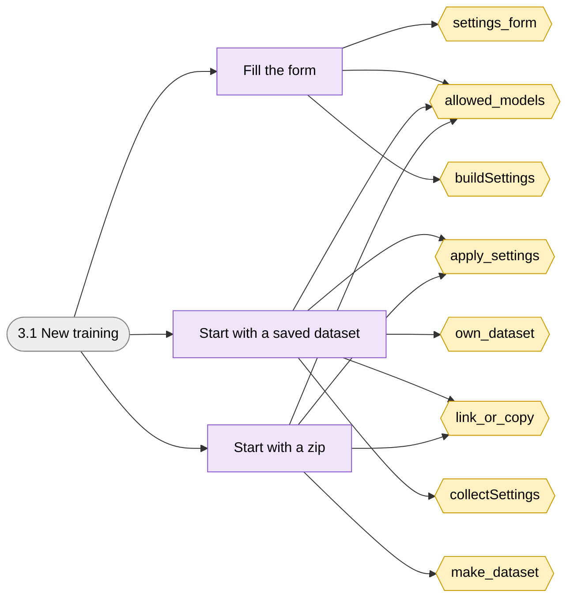
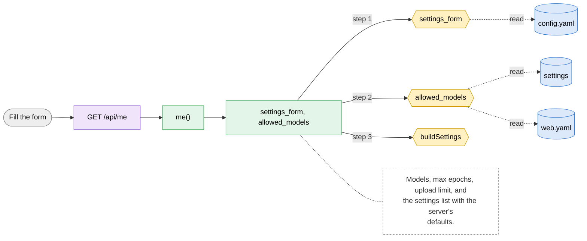
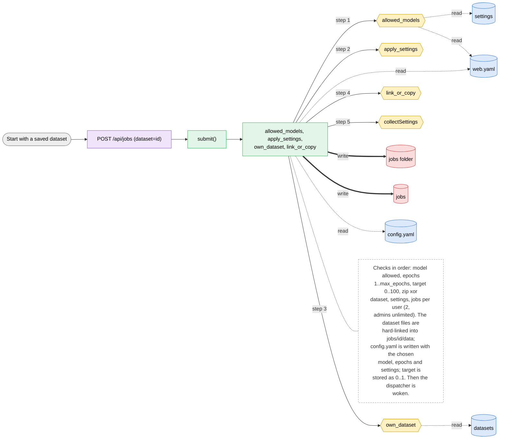
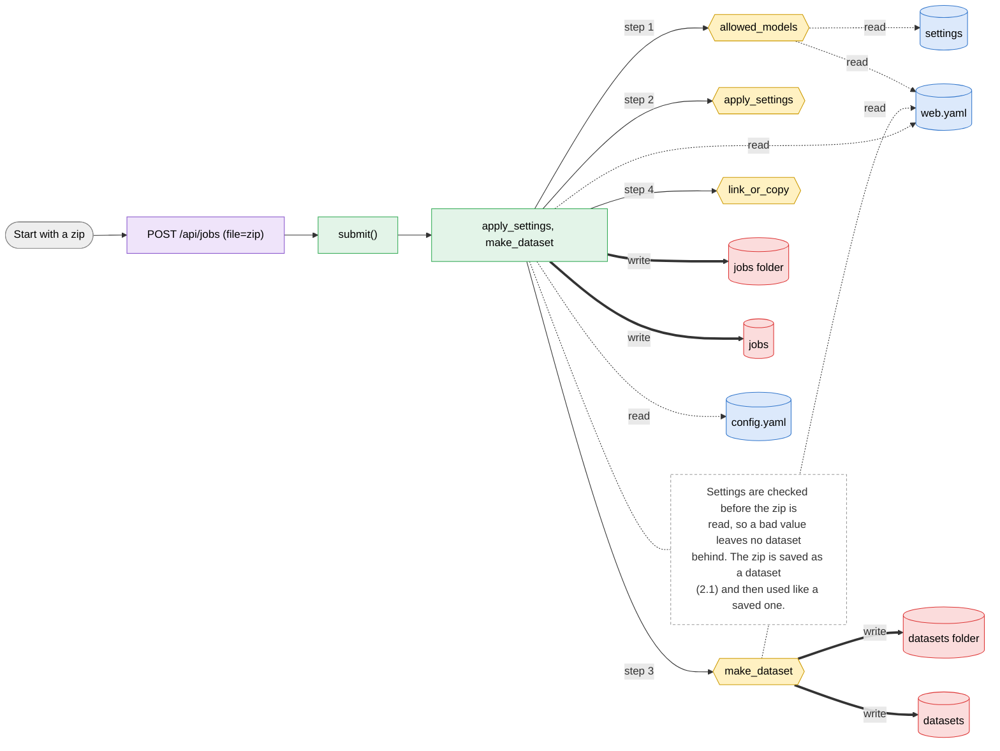

# 3.1 New training

> [!abstract] What it does
> Start a training: pick a saved dataset or send a zip, choose the model and epochs, optionally set a Target mAP50 % and change the Training settings (image size, batch, optimizer, augmentation, split...). The job gets its own copy of the settings and waits in the queue.

## Where to look (quick answer)

| Item | Value |
|---|---|
| Section | Training |
| Screen | New training (one page at `/`, tabs switch in JavaScript) |
| Routes | `GET /api/me` `POST /api/jobs (dataset=id)` `POST /api/jobs (file=zip)` |
| Handlers | `me()`, `submit()` (in `scripts/web.py` unless noted) |
| Functions / steps | [[Function Catalog#settings_form\|settings_form]], [[Function Catalog#allowed_models\|allowed_models]], [[Function Catalog#buildSettings\|buildSettings]], [[Function Catalog#apply_settings\|apply_settings]], [[Function Catalog#own_dataset\|own_dataset]], [[Function Catalog#link_or_copy\|link_or_copy]], [[Function Catalog#collectSettings\|collectSettings]], [[Function Catalog#make_dataset\|make_dataset]] |
| Stores written | [[Table Catalog#jobs folder\|jobs folder]], [[Table Catalog#jobs\|jobs]], [[Table Catalog#datasets folder\|datasets folder]], [[Table Catalog#datasets\|datasets]] |
| Stores read | [[Table Catalog#config.yaml\|config.yaml]], [[Table Catalog#settings\|settings]], [[Table Catalog#web.yaml\|web.yaml]] |

## Action map: button -> route -> Python -> function -> stores

| Action | HTTP route | Handler | Helpers | Function / step | Stores (R: / **W:**) | Notes |
|---|---|---|---|---|---|---|
| Fill the form | `GET /api/me` | `me()` | settings_form, allowed_models | [[Function Catalog#settings_form\|settings_form]] [[Function Catalog#allowed_models\|allowed_models]] [[Function Catalog#buildSettings\|buildSettings]] | R: [[Table Catalog#config.yaml\|config.yaml]], [[Table Catalog#settings\|settings]], [[Table Catalog#web.yaml\|web.yaml]] | Models, max epochs, upload limit, and the settings list with the server's defaults. |
| Start with a saved dataset | `POST /api/jobs (dataset=id)` | `submit()` | allowed_models, apply_settings, own_dataset, link_or_copy | [[Function Catalog#allowed_models\|allowed_models]] [[Function Catalog#apply_settings\|apply_settings]] [[Function Catalog#own_dataset\|own_dataset]] [[Function Catalog#link_or_copy\|link_or_copy]] [[Function Catalog#collectSettings\|collectSettings]] **Inline SQL / files in handler** | R: [[Table Catalog#settings\|settings]], [[Table Catalog#web.yaml\|web.yaml]], [[Table Catalog#datasets\|datasets]], [[Table Catalog#config.yaml\|config.yaml]] **W:** [[Table Catalog#jobs folder\|jobs folder]], [[Table Catalog#jobs\|jobs]] | Checks in order: model allowed, epochs 1..max_epochs, target 0..100, zip xor dataset, settings, jobs per user (2, admins unlimited). The dataset files are hard-linked into `jobs/<id>/data`; `config.yaml` is written with the chosen model, epochs and settings; `target` is stored as 0..1. Then the dispatcher is woken. |
| Start with a zip | `POST /api/jobs (file=zip)` | `submit()` | apply_settings, make_dataset | [[Function Catalog#allowed_models\|allowed_models]] [[Function Catalog#apply_settings\|apply_settings]] [[Function Catalog#make_dataset\|make_dataset]] [[Function Catalog#link_or_copy\|link_or_copy]] **Inline SQL / files in handler** | R: [[Table Catalog#settings\|settings]], [[Table Catalog#web.yaml\|web.yaml]], [[Table Catalog#config.yaml\|config.yaml]] **W:** [[Table Catalog#datasets folder\|datasets folder]], [[Table Catalog#datasets\|datasets]], [[Table Catalog#jobs folder\|jobs folder]], [[Table Catalog#jobs\|jobs]] | Settings are checked before the zip is read, so a bad value leaves no dataset behind. The zip is saved as a dataset (2.1) and then used like a saved one. |

_Stores = taken from the function catalog plus the SQL/file access written directly in the handler. **W** = written, R = read only. A route that says `background` is not clicked: a server thread runs it._

## Flow chart

> [!tip] How to read
> Left to right: **user action** (grey) -> **route** (purple) -> **Python handler / helper** (green) -> **function or step** (yellow, hexagon) -> **store** (cylinder: SQLite table, folder, config file or RAM). Red thick arrow = it writes the store, blue dotted arrow = it only reads. The dashed box is a note from the action map. Details of every box are in the tables above.

### Overview of 3.1 New training

### 1. Fill the form

### 2. Start with a saved dataset

### 3. Start with a zip

## Files

- `scripts/web.py` (submit, SETTINGS, apply_settings, settings_form)
- `scripts/index.html` (buildSettings, collectSettings, submit handler)
- `configuration/config.yaml` (defaults), `configuration/web.yaml` (limits)

Base path: `vision-web-gateway/` in this repo.

## Functions and stores

**Functions / steps:** [[Function Catalog#settings_form|settings_form]], [[Function Catalog#allowed_models|allowed_models]], [[Function Catalog#buildSettings|buildSettings]], [[Function Catalog#apply_settings|apply_settings]], [[Function Catalog#own_dataset|own_dataset]], [[Function Catalog#link_or_copy|link_or_copy]], [[Function Catalog#collectSettings|collectSettings]], [[Function Catalog#make_dataset|make_dataset]]

**Stores:** [[Table Catalog#jobs folder|jobs folder]] (W), [[Table Catalog#jobs|jobs]] (W), [[Table Catalog#datasets folder|datasets folder]] (W), [[Table Catalog#datasets|datasets]] (W), [[Table Catalog#config.yaml|config.yaml]], [[Table Catalog#settings|settings]], [[Table Catalog#web.yaml|web.yaml]]

## If something goes wrong

| Symptom | Check |
|---|---|
| `that model is not allowed` | The admin removed it from Admin > Models, or the page was open before the change: reload. |
| `epochs must be between 1 and N` | `max_epochs` in web.yaml. |
| `train.imgsz is not valid ...` (400) | A setting is out of range or the wrong type; the message repeats its hint. Reset to defaults and change one at a time. |
| `target mAP50 must be between 0 and 100` | Type the target in percent, or leave it empty. |
| `you already have 2 jobs waiting or running` (429) | Wait or cancel one; admins have no limit. |
| Job fails at start with a download error | The chosen model is not in `models/` and the server cannot download it. Admin > Models shows which are on the server. |

General checklist: [[Troubleshooting Guide]] (job log, server console, database).

## Related menus

- [[2.1 Datasets|2.1 Datasets]]
- [[4.2 Models|4.2 Models]]
- [[1.1 Queue and jobs|1.1 Queue and jobs]]
- [[0.2 Background workers|0.2 Background workers]]
