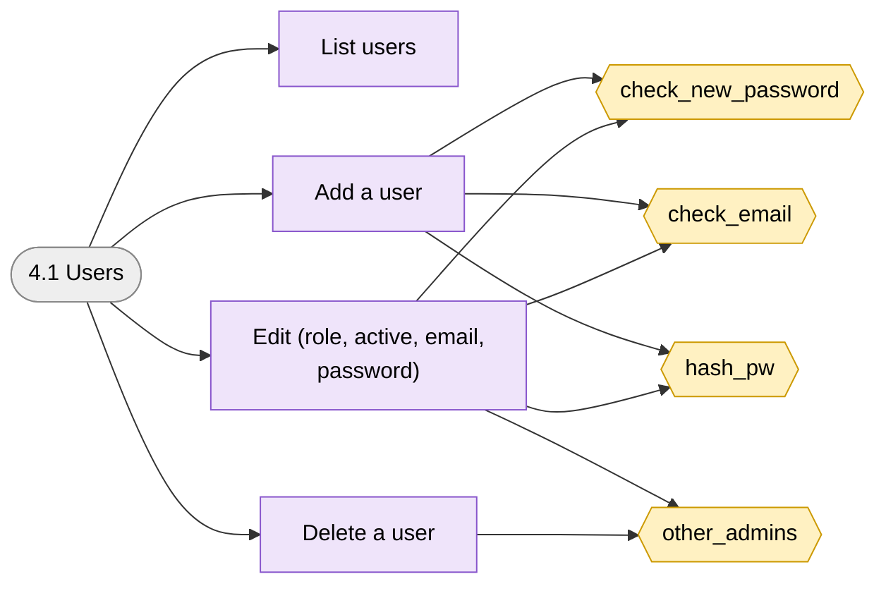
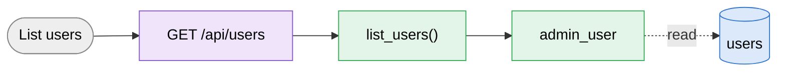
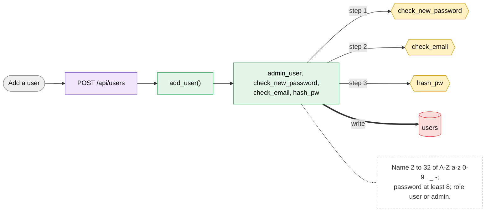
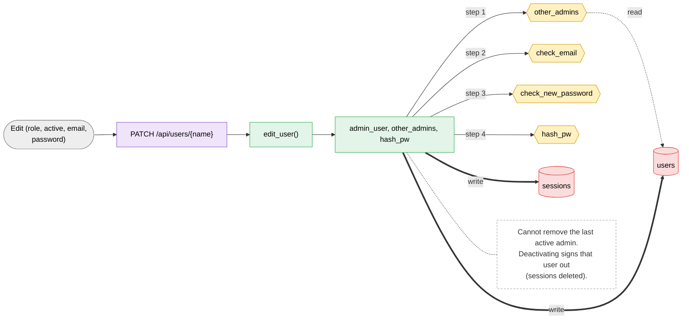
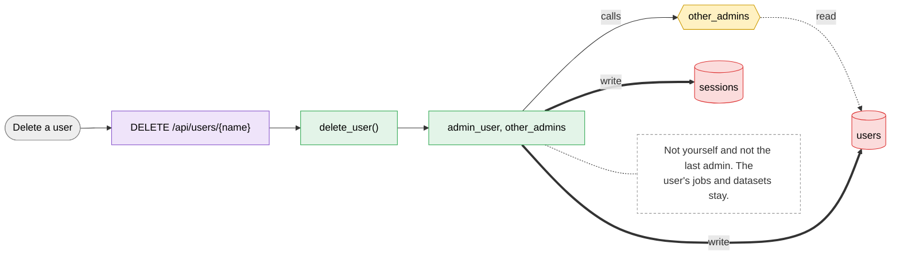

# 4.1 Users

> [!abstract] What it does
> Admin creates, edits and deletes accounts. The email is where the job result notification goes.

## Where to look (quick answer)

| Item | Value |
|---|---|
| Section | Admin |
| Screen | Admin > Users (one page at `/`, tabs switch in JavaScript) |
| Routes | `GET /api/users` `POST /api/users` `PATCH /api/users/{name}` `DELETE /api/users/{name}` |
| Handlers | `list_users()`, `add_user()`, `edit_user()`, `delete_user()` (in `scripts/web.py` unless noted) |
| Functions / steps | [[Function Catalog#check_new_password\|check_new_password]], [[Function Catalog#check_email\|check_email]], [[Function Catalog#hash_pw\|hash_pw]], [[Function Catalog#other_admins\|other_admins]] |
| Stores written | [[Table Catalog#users\|users]], [[Table Catalog#sessions\|sessions]] |
| Stores read | - |

## Action map: button -> route -> Python -> function -> stores

| Action | HTTP route | Handler | Helpers | Function / step | Stores (R: / **W:**) | Notes |
|---|---|---|---|---|---|---|
| List users | `GET /api/users` | `list_users()` | admin_user | -**Inline SQL / files in handler** | R: [[Table Catalog#users\|users]] |  |
| Add a user | `POST /api/users` | `add_user()` | admin_user, check_new_password, check_email, hash_pw | [[Function Catalog#check_new_password\|check_new_password]] [[Function Catalog#check_email\|check_email]] [[Function Catalog#hash_pw\|hash_pw]] **Inline SQL / files in handler** | **W:** [[Table Catalog#users\|users]] | Name 2 to 32 of `A-Z a-z 0-9 . _ -`; password at least 8; role user or admin. |
| Edit (role, active, email, password) | `PATCH /api/users/{name}` | `edit_user()` | admin_user, other_admins, hash_pw | [[Function Catalog#other_admins\|other_admins]] [[Function Catalog#check_email\|check_email]] [[Function Catalog#check_new_password\|check_new_password]] [[Function Catalog#hash_pw\|hash_pw]] **Inline SQL / files in handler** | **W:** [[Table Catalog#users\|users]], [[Table Catalog#sessions\|sessions]] | Cannot remove the last active admin. Deactivating signs that user out (sessions deleted). |
| Delete a user | `DELETE /api/users/{name}` | `delete_user()` | admin_user, other_admins | [[Function Catalog#other_admins\|other_admins]] **Inline SQL / files in handler** | **W:** [[Table Catalog#users\|users]], [[Table Catalog#sessions\|sessions]] | Not yourself and not the last admin. The user's jobs and datasets stay. |

_Stores = taken from the function catalog plus the SQL/file access written directly in the handler. **W** = written, R = read only. A route that says `background` is not clicked: a server thread runs it._

## Flow chart

> [!tip] How to read
> Left to right: **user action** (grey) -> **route** (purple) -> **Python handler / helper** (green) -> **function or step** (yellow, hexagon) -> **store** (cylinder: SQLite table, folder, config file or RAM). Red thick arrow = it writes the store, blue dotted arrow = it only reads. The dashed box is a note from the action map. Details of every box are in the tables above.

### Overview of 4.1 Users

### 1. List users

### 2. Add a user

### 3. Edit (role, active, email, password)

### 4. Delete a user

## Files

- `scripts/web.py` (list_users, add_user, edit_user, delete_user)
- `scripts/index.html` (loadAdmin, users table)

Base path: `vision-web-gateway/` in this repo.

## Functions and stores

**Functions / steps:** [[Function Catalog#check_new_password|check_new_password]], [[Function Catalog#check_email|check_email]], [[Function Catalog#hash_pw|hash_pw]], [[Function Catalog#other_admins|other_admins]]

**Stores:** [[Table Catalog#users|users]] (W), [[Table Catalog#sessions|sessions]] (W)

## If something goes wrong

| Symptom | Check |
|---|---|
| `that name is taken` (409) | Names are unique. |
| `keep at least one active admin` / `you cannot delete yourself or the last admin` | Make another admin first. |
| `admin only` (403) | Signed in as a normal user. |

General checklist: [[Troubleshooting Guide]] (job log, server console, database).

## Related menus

- [[5.1 Account|5.1 Account]]
- [[0.1 Sign in and sign out|0.1 Sign in and sign out]]
