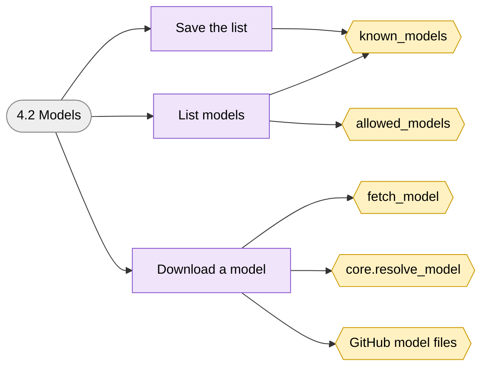
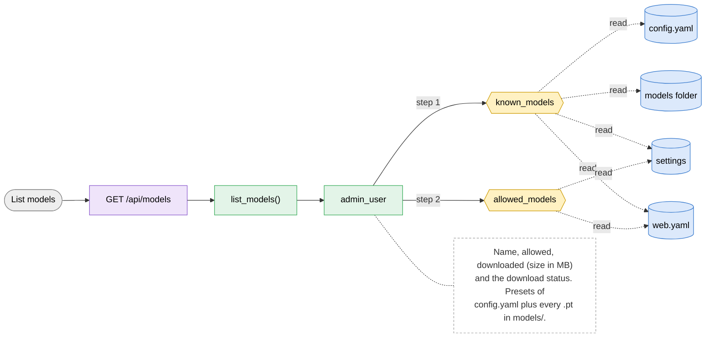
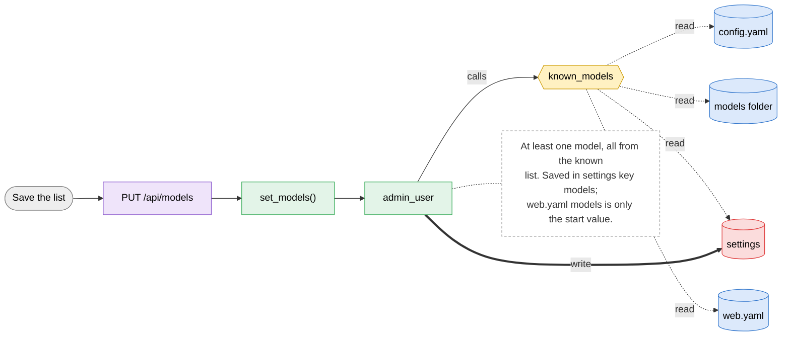
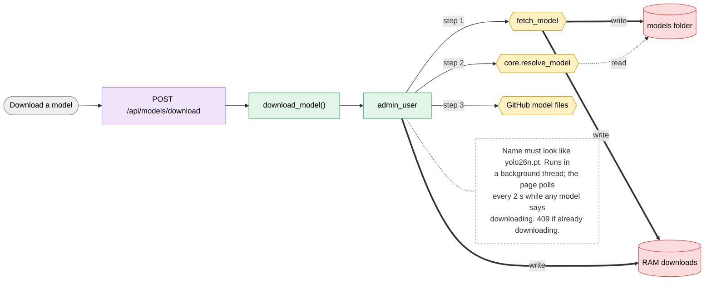

# 4.2 Models

> [!abstract] What it does
> Which models users can pick in New training (saved list), which weights are on the server, and Download for missing ones. The dropdown lists the newest and most powerful first.

## Where to look (quick answer)

| Item | Value |
|---|---|
| Section | Admin |
| Screen | Admin > Models (one page at `/`, tabs switch in JavaScript) |
| Routes | `GET /api/models` `PUT /api/models` `POST /api/models/download` |
| Handlers | `list_models()`, `set_models()`, `download_model()` (in `scripts/web.py` unless noted) |
| Functions / steps | [[Function Catalog#known_models\|known_models]], [[Function Catalog#allowed_models\|allowed_models]], [[Function Catalog#fetch_model\|fetch_model]], [[Function Catalog#core.resolve_model\|core.resolve_model]], [[Function Catalog#GitHub model files\|GitHub model files]] |
| Stores written | [[Table Catalog#settings\|settings]], [[Table Catalog#models folder\|models folder]], [[Table Catalog#RAM downloads\|RAM downloads]] |
| Stores read | [[Table Catalog#config.yaml\|config.yaml]], [[Table Catalog#web.yaml\|web.yaml]] |

## Action map: button -> route -> Python -> function -> stores

| Action | HTTP route | Handler | Helpers | Function / step | Stores (R: / **W:**) | Notes |
|---|---|---|---|---|---|---|
| List models | `GET /api/models` | `list_models()` | admin_user | [[Function Catalog#known_models\|known_models]] [[Function Catalog#allowed_models\|allowed_models]] | R: [[Table Catalog#config.yaml\|config.yaml]], [[Table Catalog#models folder\|models folder]], [[Table Catalog#settings\|settings]], [[Table Catalog#web.yaml\|web.yaml]] | Name, allowed, downloaded (size in MB) and the download status. Presets of config.yaml plus every `.pt` in models/. |
| Save the list | `PUT /api/models` | `set_models()` | admin_user | [[Function Catalog#known_models\|known_models]] **Inline SQL / files in handler** | R: [[Table Catalog#config.yaml\|config.yaml]], [[Table Catalog#models folder\|models folder]], [[Table Catalog#web.yaml\|web.yaml]] **W:** [[Table Catalog#settings\|settings]] | At least one model, all from the known list. Saved in `settings` key `models`; web.yaml `models` is only the start value. |
| Download a model | `POST /api/models/download` | `download_model()` | admin_user | [[Function Catalog#fetch_model\|fetch_model]] [[Function Catalog#core.resolve_model\|core.resolve_model]] [[Function Catalog#GitHub model files\|GitHub model files]] **Inline SQL / files in handler** | **W:** [[Table Catalog#models folder\|models folder]], [[Table Catalog#RAM downloads\|RAM downloads]] | Name must look like `yolo26n.pt`. Runs in a background thread; the page polls every 2 s while any model says `downloading`. 409 if already downloading. |

_Stores = taken from the function catalog plus the SQL/file access written directly in the handler. **W** = written, R = read only. A route that says `background` is not clicked: a server thread runs it._

## Flow chart

> [!tip] How to read
> Left to right: **user action** (grey) -> **route** (purple) -> **Python handler / helper** (green) -> **function or step** (yellow, hexagon) -> **store** (cylinder: SQLite table, folder, config file or RAM). Red thick arrow = it writes the store, blue dotted arrow = it only reads. The dashed box is a note from the action map. Details of every box are in the tables above.

### Overview of 4.2 Models

### 1. List models

### 2. Save the list

### 3. Download a model

## Files

- `scripts/web.py` (list_models, set_models, download_model, fetch_model, newest_first)
- `scripts/index.html` (loadModels, downloadModel)
- `configuration/config.yaml` (`model_presets`)
- `models/` folder

Base path: `vision-web-gateway/` in this repo.

## Functions and stores

**Functions / steps:** [[Function Catalog#known_models|known_models]], [[Function Catalog#allowed_models|allowed_models]], [[Function Catalog#fetch_model|fetch_model]], [[Function Catalog#core.resolve_model|core.resolve_model]], [[Function Catalog#GitHub model files|GitHub model files]]

**Stores:** [[Table Catalog#settings|settings]] (W), [[Table Catalog#models folder|models folder]] (W), [[Table Catalog#RAM downloads|RAM downloads]] (W), [[Table Catalog#config.yaml|config.yaml]], [[Table Catalog#web.yaml|web.yaml]]

## If something goes wrong

| Symptom | Check |
|---|---|
| Every Download says `error: Download failure ... Retry limit reached` | The server cannot reach GitHub (`github.com`, `release-assets.githubusercontent.com`, port 443): firewall, proxy or SSL inspection. |
| Log shows `SSLCertVerificationError ... self-signed certificate in certificate chain` | A company proxy re-signs HTTPS with its own root. Fix: `pip install pip-system-certs` in `.venv` (uses the Windows certificate store) or set `SSL_CERT_FILE` / `REQUESTS_CA_BUNDLE` to the company root `.pem`. Do not turn verification off. Quick workaround: copy the `.pt` into `models/`. |
| Save list did nothing | A list of at least one known model is required (400). Ticks are kept while the table refreshes. |
| Model ticked but not downloaded | Allowed, so users can pick it; the first training that uses it will try to download it and may fail. |

General checklist: [[Troubleshooting Guide]] (job log, server console, database).

## Related menus

- [[3.1 New training|3.1 New training]]
- [[0.2 Background workers|0.2 Background workers]]
