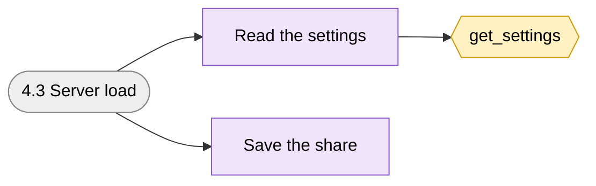
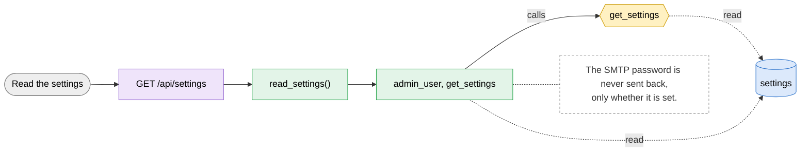
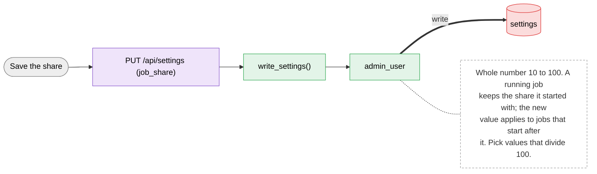

# 4.3 Server load

> [!abstract] What it does
> Share of the server per job: 100 = one training at a time, 50 = two, 33 = three, 25 = four. The share limits CPU threads, RAM and GPU memory (so the batch size) of one job.

## Where to look (quick answer)

| Item | Value |
|---|---|
| Section | Admin |
| Screen | Admin > Server load (one page at `/`, tabs switch in JavaScript) |
| Routes | `GET /api/settings` `PUT /api/settings (job_share)` |
| Handlers | `read_settings()`, `write_settings()` (in `scripts/web.py` unless noted) |
| Functions / steps | [[Function Catalog#get_settings\|get_settings]] |
| Stores written | [[Table Catalog#settings\|settings]] |
| Stores read | - |

## Action map: button -> route -> Python -> function -> stores

| Action | HTTP route | Handler | Helpers | Function / step | Stores (R: / **W:**) | Notes |
|---|---|---|---|---|---|---|
| Read the settings | `GET /api/settings` | `read_settings()` | admin_user, get_settings | [[Function Catalog#get_settings\|get_settings]] **Inline SQL / files in handler** | R: [[Table Catalog#settings\|settings]] | The SMTP password is never sent back, only whether it is set. |
| Save the share | `PUT /api/settings (job_share)` | `write_settings()` | admin_user | -**Inline SQL / files in handler** | **W:** [[Table Catalog#settings\|settings]] | Whole number 10 to 100. A running job keeps the share it started with; the new value applies to jobs that start after it. Pick values that divide 100. |

_Stores = taken from the function catalog plus the SQL/file access written directly in the handler. **W** = written, R = read only. A route that says `background` is not clicked: a server thread runs it._

## Flow chart

> [!tip] How to read
> Left to right: **user action** (grey) -> **route** (purple) -> **Python handler / helper** (green) -> **function or step** (yellow, hexagon) -> **store** (cylinder: SQLite table, folder, config file or RAM). Red thick arrow = it writes the store, blue dotted arrow = it only reads. The dashed box is a note from the action map. Details of every box are in the tables above.

### Overview of 4.3 Server load

### 1. Read the settings

### 2. Save the share

## Files

- `scripts/web.py` (read_settings, write_settings, dispatcher)
- `scripts/index.html` (loadForm)

Base path: `vision-web-gateway/` in this repo.

## Functions and stores

**Functions / steps:** [[Function Catalog#get_settings|get_settings]]

**Stores:** [[Table Catalog#settings|settings]] (W)

## If something goes wrong

| Symptom | Check |
|---|---|
| `the share per job must be a whole number from 10 to 100` | Type 100, 50, 33 or 25. |
| Two jobs run but each is slow | They share the GPU; the share only decides who runs together, it does not cap GPU compute. |
| Still one job at a time after setting 50 | Running jobs keep their old share; the next job to start uses the new value. 60 would still run one at a time. |

General checklist: [[Troubleshooting Guide]] (job log, server console, database).

## Related menus

- [[0.2 Background workers|0.2 Background workers]]
- [[4.4 Notifications|4.4 Notifications]]
