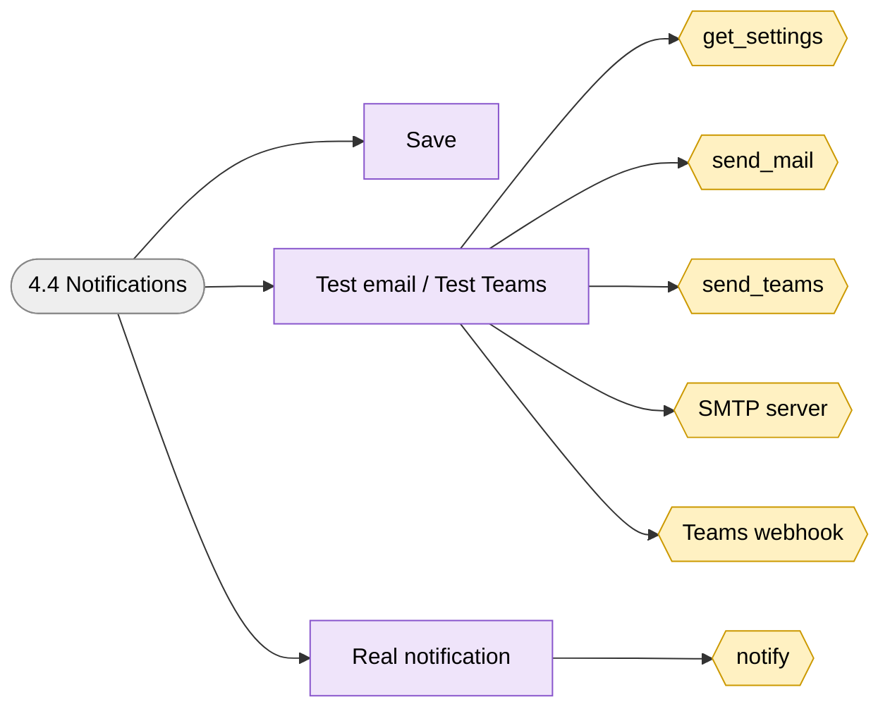
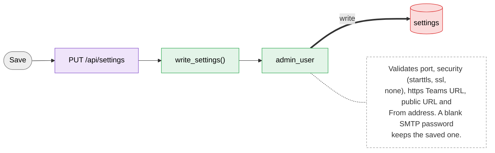
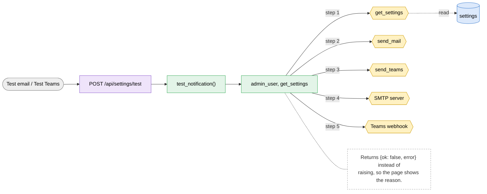
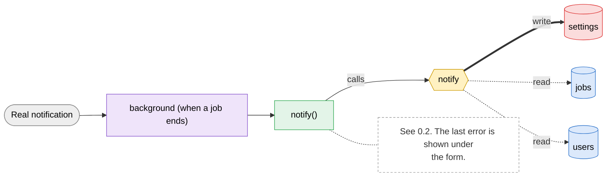

# 4.4 Notifications

> [!abstract] What it does
> SMTP email to the job owner and an optional Teams channel post when a job finishes, fails or is cancelled. Save first, then press Test.

## Where to look (quick answer)

| Item | Value |
|---|---|
| Section | Admin |
| Screen | Admin > Notifications (one page at `/`, tabs switch in JavaScript) |
| Routes | `PUT /api/settings` `POST /api/settings/test` `background (when a job ends)` |
| Handlers | `write_settings()`, `test_notification()`, `notify()` (in `scripts/web.py` unless noted) |
| Functions / steps | [[Function Catalog#get_settings\|get_settings]], [[Function Catalog#send_mail\|send_mail]], [[Function Catalog#send_teams\|send_teams]], [[Function Catalog#SMTP server\|SMTP server]], [[Function Catalog#Teams webhook\|Teams webhook]], [[Function Catalog#notify\|notify]] |
| Stores written | [[Table Catalog#settings\|settings]] |
| Stores read | [[Table Catalog#jobs\|jobs]], [[Table Catalog#users\|users]] |

## Action map: button -> route -> Python -> function -> stores

| Action | HTTP route | Handler | Helpers | Function / step | Stores (R: / **W:**) | Notes |
|---|---|---|---|---|---|---|
| Save | `PUT /api/settings` | `write_settings()` | admin_user | -**Inline SQL / files in handler** | **W:** [[Table Catalog#settings\|settings]] | Validates port, security (starttls, ssl, none), https Teams URL, public URL and From address. A blank SMTP password keeps the saved one. |
| Test email / Test Teams | `POST /api/settings/test` | `test_notification()` | admin_user, get_settings | [[Function Catalog#get_settings\|get_settings]] [[Function Catalog#send_mail\|send_mail]] [[Function Catalog#send_teams\|send_teams]] [[Function Catalog#SMTP server\|SMTP server]] [[Function Catalog#Teams webhook\|Teams webhook]] | R: [[Table Catalog#settings\|settings]] | Returns `{ok: false, error}` instead of raising, so the page shows the reason. |
| Real notification | `background (when a job ends)` | `notify()` | - | [[Function Catalog#notify\|notify]] | R: [[Table Catalog#jobs\|jobs]], [[Table Catalog#users\|users]] **W:** [[Table Catalog#settings\|settings]] | See 0.2. The last error is shown under the form. |

_Stores = taken from the function catalog plus the SQL/file access written directly in the handler. **W** = written, R = read only. A route that says `background` is not clicked: a server thread runs it._

## Flow chart

> [!tip] How to read
> Left to right: **user action** (grey) -> **route** (purple) -> **Python handler / helper** (green) -> **function or step** (yellow, hexagon) -> **store** (cylinder: SQLite table, folder, config file or RAM). Red thick arrow = it writes the store, blue dotted arrow = it only reads. The dashed box is a note from the action map. Details of every box are in the tables above.

### Overview of 4.4 Notifications

### 1. Save

### 2. Test email / Test Teams

### 3. Real notification

## Files

- `scripts/web.py` (read_settings, write_settings, test_notification, notify, send_mail, send_teams)
- `scripts/index.html` (setForm, testMail, testTeams)

Base path: `vision-web-gateway/` in this repo.

## Functions and stores

**Functions / steps:** [[Function Catalog#get_settings|get_settings]], [[Function Catalog#send_mail|send_mail]], [[Function Catalog#send_teams|send_teams]], [[Function Catalog#SMTP server|SMTP server]], [[Function Catalog#Teams webhook|Teams webhook]], [[Function Catalog#notify|notify]]

**Stores:** [[Table Catalog#settings|settings]] (W), [[Table Catalog#jobs|jobs]], [[Table Catalog#users|users]]

## If something goes wrong

| Symptom | Check |
|---|---|
| `fill in the SMTP server and the From address first` | Both are required before an email can be sent. |
| SMTP error in the last-error line | Wrong host, port or security; the server may need a login or may block this PC. Test with the same values from another mail client. |
| Teams message does not appear | The webhook URL must be https. The Adaptive Card was not tested against a real tenant: use the test button first. |
| No email for a user | That user has no email (Account, or Admin > Users), or `email the job owner` is unticked. |

General checklist: [[Troubleshooting Guide]] (job log, server console, database).

## Related menus

- [[4.3 Server load|4.3 Server load]]
- [[5.1 Account|5.1 Account]]
- [[0.2 Background workers|0.2 Background workers]]
