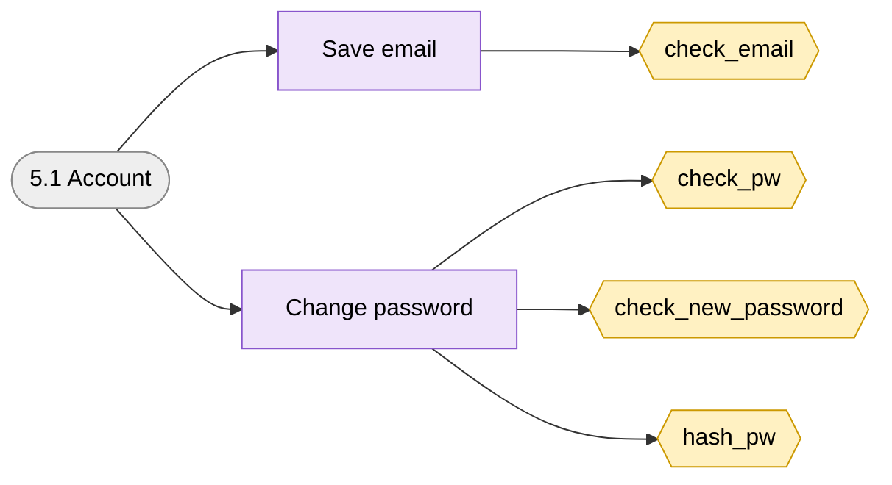
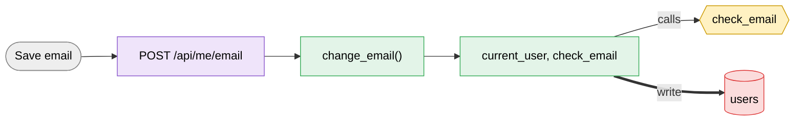
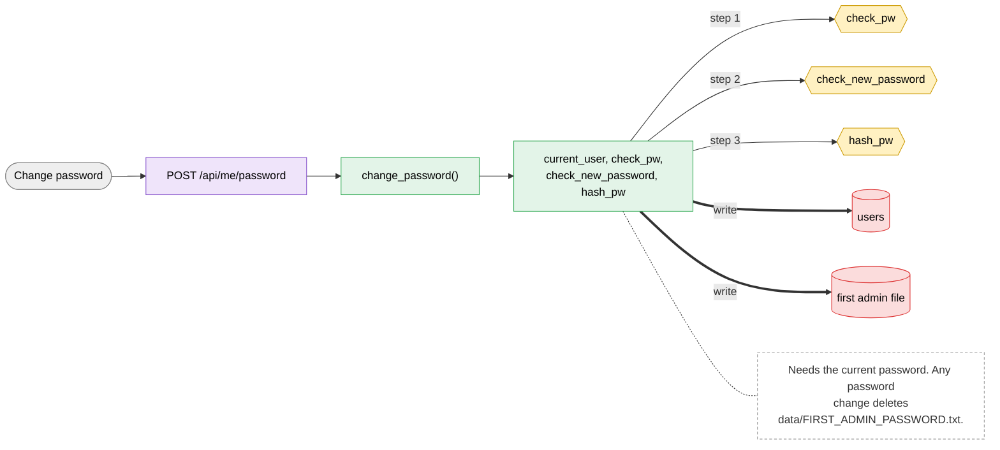

# 5.1 Account

> [!abstract] What it does
> Every user: save own email (for notifications) and change own password.

## Where to look (quick answer)

| Item | Value |
|---|---|
| Section | Account |
| Screen | Account (one page at `/`, tabs switch in JavaScript) |
| Routes | `POST /api/me/email` `POST /api/me/password` |
| Handlers | `change_email()`, `change_password()` (in `scripts/web.py` unless noted) |
| Functions / steps | [[Function Catalog#check_email\|check_email]], [[Function Catalog#check_pw\|check_pw]], [[Function Catalog#check_new_password\|check_new_password]], [[Function Catalog#hash_pw\|hash_pw]] |
| Stores written | [[Table Catalog#users\|users]], [[Table Catalog#first admin file\|first admin file]] |
| Stores read | - |

## Action map: button -> route -> Python -> function -> stores

| Action | HTTP route | Handler | Helpers | Function / step | Stores (R: / **W:**) | Notes |
|---|---|---|---|---|---|---|
| Save email | `POST /api/me/email` | `change_email()` | current_user, check_email | [[Function Catalog#check_email\|check_email]] **Inline SQL / files in handler** | **W:** [[Table Catalog#users\|users]] |  |
| Change password | `POST /api/me/password` | `change_password()` | current_user, check_pw, check_new_password, hash_pw | [[Function Catalog#check_pw\|check_pw]] [[Function Catalog#check_new_password\|check_new_password]] [[Function Catalog#hash_pw\|hash_pw]] **Inline SQL / files in handler** | **W:** [[Table Catalog#users\|users]], [[Table Catalog#first admin file\|first admin file]] | Needs the current password. Any password change deletes `data/FIRST_ADMIN_PASSWORD.txt`. |

_Stores = taken from the function catalog plus the SQL/file access written directly in the handler. **W** = written, R = read only. A route that says `background` is not clicked: a server thread runs it._

## Flow chart

> [!tip] How to read
> Left to right: **user action** (grey) -> **route** (purple) -> **Python handler / helper** (green) -> **function or step** (yellow, hexagon) -> **store** (cylinder: SQLite table, folder, config file or RAM). Red thick arrow = it writes the store, blue dotted arrow = it only reads. The dashed box is a note from the action map. Details of every box are in the tables above.

### Overview of 5.1 Account

### 1. Save email

### 2. Change password

## Files

- `scripts/web.py` (change_email, change_password)
- `scripts/index.html` (emailForm, pwForm)

Base path: `vision-web-gateway/` in this repo.

## Functions and stores

**Functions / steps:** [[Function Catalog#check_email|check_email]], [[Function Catalog#check_pw|check_pw]], [[Function Catalog#check_new_password|check_new_password]], [[Function Catalog#hash_pw|hash_pw]]

**Stores:** [[Table Catalog#users|users]] (W), [[Table Catalog#first admin file|first admin file]] (W)

## If something goes wrong

| Symptom | Check |
|---|---|
| `the current password is wrong` | Type the current password again. |
| `password needs at least 8 characters` | Use 8 or more. |
| `that email address does not look right` | Use `name@company.com`. |

General checklist: [[Troubleshooting Guide]] (job log, server console, database).

## Related menus

- [[4.1 Users|4.1 Users]]
- [[4.4 Notifications|4.4 Notifications]]
